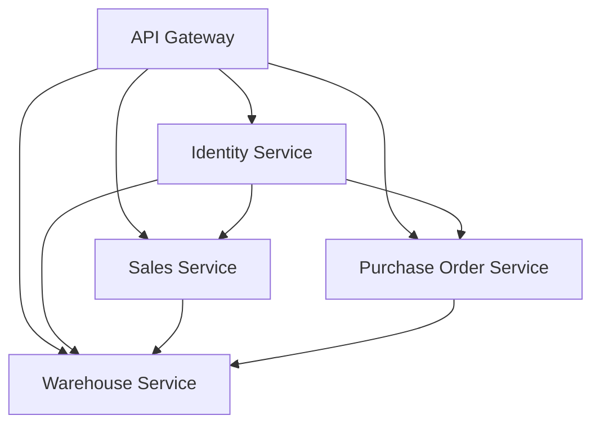

# Service Map

ERP E-Commerce Solution is built using a Microservice Architecture.

Core Domains:

- Identity
- Sales
- Purchasing
- Warehouse

Communication:

- REST API
- RabbitMQ
- Kafka

Gateway:

- Ocelot API Gateway

## Service Relationships

