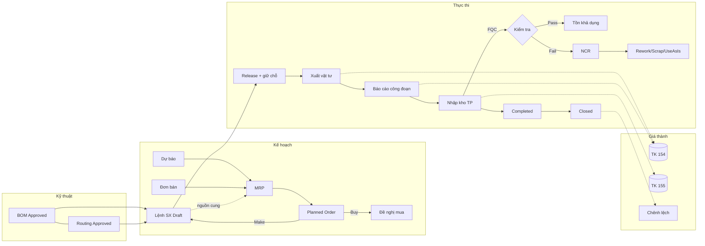
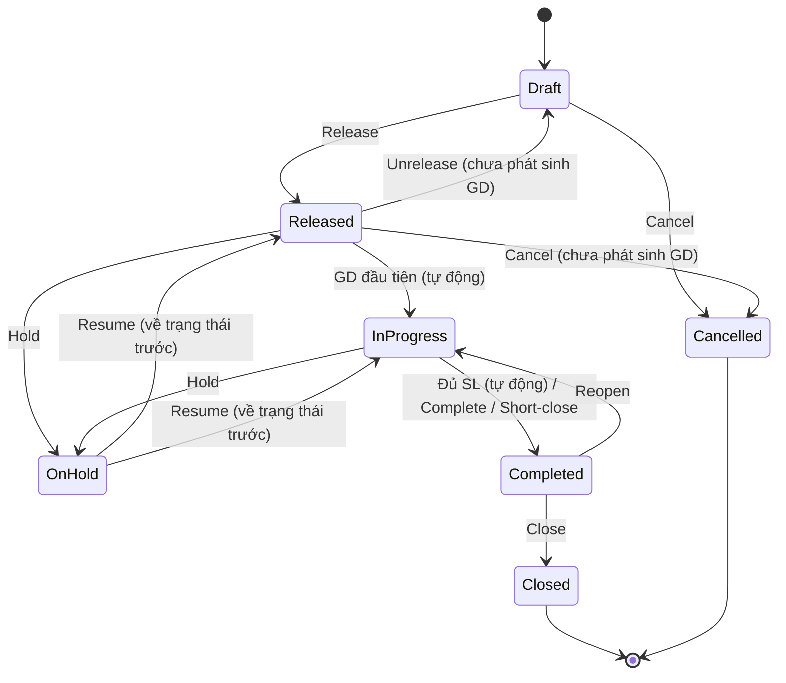
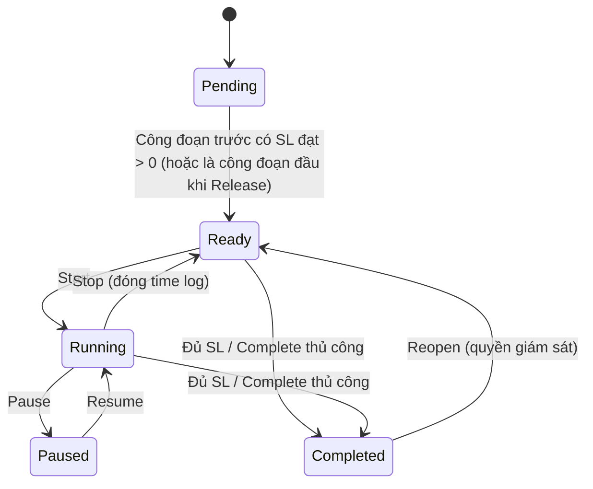
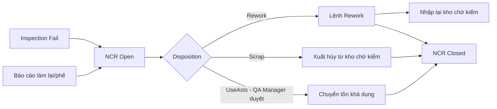

# MODULE SẢN XUẤT (PRODUCTION / MANUFACTURING) — ĐẶC TẢ NGHIỆP VỤ

> **Vai trò tác giả:** Senior BA
> **Dự án:** ERP.E_Commerce (Clean Architecture, .NET 10, SQL Server, EF Core)
> **Mã module:** `PRD` · **DB schema:** `production` · **Namespace gốc:** `ERP.E_Commerce.*.Production`
> **Tài liệu liên quan:** `02_PRODUCTION_DEV_TASKS.md` (task Dev) · `03_PRODUCTION_TEST_CASES.md` (test case QA)
> **Phiên bản:** 1.0 · 2026-11-04

---

## 0. HƯỚNG DẪN DÙNG TÀI LIỆU CHO AI-ASSISTED CODING

1. Mọi quy tắc nghiệp vụ có mã **`BR-{AREA}-{NN}`**. Khi sinh code, validator/domain method phải ghi chú mã BR tương ứng trong XML comment, ví dụ `/// <remarks>BR-PO-17</remarks>`.
2. Mọi lỗi nghiệp vụ dùng mã **`PRD_{AREA}_{NNN}`** và thông điệp tiếng Việt ở **Phụ lục A**. Không tự đặt thông điệp mới khi đã có mã.
3. Mục **§7 Mô hình dữ liệu** là nguồn chuẩn cho Entity + EF Fluent API. Không thêm cột ngoài danh sách nếu chưa cập nhật tài liệu.
4. Mục **§8 Hợp đồng tích hợp** là các interface module Sản xuất **gọi ra**; module Sản xuất **không** truy cập trực tiếp bảng của module khác.
5. Tuân thủ quy ước dự án: method async trả `Task`, `ApiResponse<T>`, `PaginatedResult<T>`, Fluent API cho mọi cấu hình DbContext, AutoMapper chỉ ở tầng Service, stored procedure đặt tên `sp_ActionEntityName`, thông điệp lỗi tiếng Việt.

---

## 1. PHẠM VI & GIẢ ĐỊNH

### 1.1 Mục tiêu
Quản lý toàn bộ vòng đời sản xuất: từ dữ liệu kỹ thuật (BOM, quy trình công nghệ) → lập kế hoạch (MPS/MRP, năng lực) → thực thi (lệnh sản xuất, cấp phát vật tư, báo cáo công đoạn, nhập kho thành phẩm) → chất lượng → giá thành → báo cáo KPI.

### 1.2 Mô hình sản xuất hỗ trợ
| Mô hình | Hỗ trợ | Ghi chú |
|---|---|---|
| Sản xuất rời rạc (discrete), lắp ráp nhiều cấp | ✅ | Trọng tâm |
| Sản xuất theo lô (batch) có kiểm soát lô/hạn dùng | ✅ | Lot/expiry, FEFO |
| Make-to-Stock (MTS) | ✅ | Từ dự báo + tồn an toàn |
| Make-to-Order (MTO) | ✅ | Từ đơn bán, pegging |
| Gia công ngoài (subcontracting) | ✅ (giai đoạn sau) | |
| Sản xuất quy trình liên tục (process/recipe, potency) | ❌ | Ngoài phạm vi v1 |
| Lập lịch tối ưu nâng cao (APS), IoT/MES kết nối máy | ❌ | Ngoài phạm vi v1 |

### 1.3 Giả định
- Đơn vị tiền tệ VND, hệ thống kế toán theo **Thông tư 200** (tài khoản cấu hình được).
- Múi giờ nghiệp vụ theo nhà máy, mặc định `Asia/Ho_Chi_Minh`; lưu thời gian dạng UTC.
- Các module sau đã có hoặc sẽ có trước khi triển khai phần phụ thuộc: **Item/Product, UoM, Warehouse, Inventory (tồn kho, lô, reservation), Department, Employee, Identity/Permission, Document numbering**. Sales/Purchasing/Finance cần cho MRP và Giá thành.
- Kiến trúc modular monolith, chung SQL Server; giao dịch tồn kho của module Sản xuất thực hiện **trong cùng DB transaction** qua Unit of Work.

### 1.4 Ngoài phạm vi
PLM/CAD, tính lương khoán theo sản phẩm (thuộc HR), quản lý chất lượng đầu vào khi mua hàng (IQC thuộc Purchasing), kết nối PLC/SCADA.

---

## 2. TÁC NHÂN (ACTORS) & VAI TRÒ

| Mã | Vai trò | Trách nhiệm chính |
|---|---|---|
| R-ENG | Kỹ sư công nghệ | BOM, quy trình công nghệ (routing), công đoạn chuẩn |
| R-PLN | Nhân viên kế hoạch | Dự báo, chạy MRP, lệnh sản xuất, điều độ |
| R-PMG | Quản đốc / Trưởng phòng SX | Duyệt BOM/routing, phát hành/đóng lệnh, short-close |
| R-SUP | Tổ trưởng chuyền | Điều phối công đoạn, xác nhận báo cáo, downtime |
| R-OPR | Công nhân vận hành | Bắt đầu/dừng công đoạn, báo cáo sản lượng (tablet) |
| R-WHK | Thủ kho | Xuất/trả vật tư, nhập kho thành phẩm |
| R-QCI | Nhân viên QC | Kiểm tra IPQC/FQC, lập NCR |
| R-QAM | Trưởng QA | Phê duyệt xử lý NCR (đặc biệt Use-As-Is) |
| R-ACC | Kế toán giá thành | Giá thành chuẩn/thực tế, chênh lệch, khóa kỳ |
| R-ADM | Quản trị hệ thống | Tham số, danh mục, phân quyền |

---

## 3. DANH SÁCH HẠNG MỤC CHỨC NĂNG (FUNCTIONAL BREAKDOWN)

### A. Danh mục nền & tham số (Master data)
| Mã | Hạng mục | Mô tả |
|---|---|---|
| A01 | Tham số sản xuất | Dung sai, phương pháp xuất kho, giá thành, MRP… theo nhà máy |
| A02 | Nhà máy (Plant) | Đơn vị sản xuất; kho NVL/TP/chờ kiểm/phế mặc định |
| A03 | Hồ sơ sản xuất của mặt hàng | Make/Buy, lead time, chính sách lô, tồn an toàn, FQC, hạn dùng |
| A04 | Ca làm việc | Giờ bắt đầu/kết thúc, nghỉ giữa ca, ca qua đêm |
| A05 | Lịch làm việc | Mẫu tuần + ngày ngoại lệ (lễ, tăng ca) |
| A06 | Trung tâm công việc (Work Center) | Năng lực, hiệu suất, đơn giá nhân công/máy |
| A07 | Máy móc thiết bị | Thuộc work center, chu kỳ lý tưởng (OEE) |
| A08 | Công đoạn chuẩn | Mẫu công đoạn tái sử dụng cho routing |
| A09 | Mã lý do | Phế phẩm, làm lại, dừng máy, hủy lệnh, tạm dừng, short-close |
| A10 | Tổ sản xuất & nhân công | Tổ, thành viên, đơn giá riêng (tuỳ chọn) |

### B. Dữ liệu kỹ thuật (Engineering)
| Mã | Hạng mục | Mô tả |
|---|---|---|
| B01 | Định mức nguyên vật liệu (BOM) | Nhiều cấp, phiên bản, hiệu lực, hao hụt, phantom, thay thế, đồng/phụ phẩm |
| B02 | Quy trình công nghệ (Routing) | Chuỗi công đoạn, thời gian setup/chạy, chờ/di chuyển |
| B03 | Liên kết BOM–Routing | Vật tư tiêu hao tại công đoạn |
| B04 | Tra cứu BOM | Phân rã nhiều cấp (indented), where-used, so sánh phiên bản |
| B05 | Yêu cầu thay đổi kỹ thuật (ECO) | Giai đoạn sau |

### C. Kế hoạch sản xuất (Planning)
| Mã | Hạng mục | Mô tả |
|---|---|---|
| C01 | Dự báo nhu cầu | Theo mặt hàng/kỳ |
| C02 | MPS | Kế hoạch sản xuất tổng thể cho mặt hàng cấp 0 (planned order đã firm) |
| C03 | MRP | Hoạch định nhu cầu vật tư, planned order, pegging, thông điệp ngoại lệ |
| C04 | Chuyển đổi planned order | → Lệnh sản xuất (Make) / Đề nghị mua hàng (Buy) |
| C05 | Năng lực (CRP) | Tải vs năng lực work center |
| C06 | Điều độ (Scheduling) | Lập lịch lùi/tiến, Gantt (giai đoạn sau: hữu hạn năng lực) |

### D. Thực thi sản xuất (Execution)
| Mã | Hạng mục | Mô tả |
|---|---|---|
| D01 | Lệnh sản xuất (MO) | Vòng đời, snapshot BOM/routing, giữ chỗ vật tư |
| D02 | Yêu cầu cấp vật tư | Tổ trưởng yêu cầu → kho cấp |
| D03 | Xuất vật tư cho sản xuất | Thủ công, theo lô/serial, FEFO |
| D04 | Trả vật tư dư | Trả lại kho |
| D05 | Backflush | Tự trừ vật tư khi báo cáo/nhập kho |
| D06 | Thay thế vật tư / vật tư ngoài định mức | |
| D07 | Báo cáo công đoạn | Bắt đầu/dừng, sản lượng đạt/phế/làm lại, giờ công |
| D08 | Ghi nhận dừng máy (downtime) | Phục vụ OEE |
| D09 | Nhập kho thành phẩm/đồng/phụ phẩm | Sinh lô, hạn dùng, chờ kiểm |
| D10 | Đảo chứng từ (reversal) | Báo cáo công đoạn, nhập kho |
| D11 | Lệnh con cho bán thành phẩm | |
| D12 | Lệnh làm lại (Rework) | Từ NCR |
| D13 | Gia công ngoài | |
| D14 | Truy xuất nguồn gốc (genealogy) | Xuôi/ngược theo lô |
| D15 | Giao diện xưởng (Shop-floor tablet) | Quét mã, thao tác nhanh |

### E. Chất lượng trong sản xuất (Quality)
| Mã | Hạng mục | Mô tả |
|---|---|---|
| E01 | Kế hoạch kiểm tra | Tiêu chí định lượng/định tính, cỡ mẫu |
| E02 | Kiểm tra trong quá trình (IPQC) | Tại công đoạn |
| E03 | Kiểm tra thành phẩm (FQC) | Hàng chờ kiểm (quarantine) |
| E04 | Phiếu không phù hợp (NCR) & xử lý | Rework / Scrap / Use-As-Is |

### F. Giá thành (Costing)
| Mã | Hạng mục | Mô tả |
|---|---|---|
| F01 | Kỳ giá thành & khóa sổ | |
| F02 | Giá thành chuẩn (cost roll-up) | |
| F03 | Tập hợp chi phí thực tế theo lệnh | NVL, nhân công, sản xuất chung, gia công |
| F04 | Phân tích chênh lệch | Lượng, giá, hiệu suất |
| F05 | Đánh giá dở dang (WIP) | |
| F06 | Hạch toán kế toán | Tích hợp Finance (TK 152/154/155/621/622/627) |

### G. Bảo trì (giai đoạn sau)
G01 Kế hoạch bảo trì phòng ngừa · G02 Phiếu sửa chữa sự cố (liên kết downtime).

### H. Báo cáo & KPI
| Mã | Báo cáo |
|---|---|
| H01 | Tình trạng lệnh sản xuất / trễ hạn |
| H02 | Dở dang (WIP) theo lệnh, work center |
| H03 | Tiêu hao vật tư thực tế vs định mức |
| H04 | Sản lượng, tỷ lệ đạt (yield), tỷ lệ phế |
| H05 | OEE theo máy/work center |
| H06 | Tải năng lực work center |
| H07 | Tỷ lệ hoàn thành đúng hạn |
| H08 | Giá thành sản phẩm & chênh lệch |
| H09 | Truy xuất nguồn gốc lô |
| H10 | Dashboard điều hành sản xuất |

---

## 4. QUY TRÌNH NGHIỆP VỤ TỔNG THỂ



### 4.1 Quy trình chính (happy path MTS)
1. R-ENG tạo BOM + Routing (Draft) → R-PMG phê duyệt.
2. R-PLN nhập dự báo / hệ thống lấy đơn bán → chạy MRP → firm & chuyển planned order thành Lệnh SX (Draft).
3. R-PLN kiểm tra lịch, kiểm tra khả dụng vật tư → **Release**; hệ thống giữ chỗ vật tư.
4. R-SUP lập yêu cầu cấp vật tư (tuỳ chọn) → R-WHK xuất vật tư theo lô (FEFO).
5. R-OPR bắt đầu công đoạn, báo cáo sản lượng đạt/phế; vật tư backflush tự trừ.
6. R-WHK nhập kho thành phẩm; nếu mặt hàng yêu cầu FQC → hàng vào kho chờ kiểm.
7. R-QCI kiểm tra FQC → Pass: chuyển tồn khả dụng; Fail: NCR → xử lý.
8. Lệnh đạt số lượng → **Completed**; R-WHK trả vật tư dư; R-ACC tính giá thành → **Closed**.

### 4.2 Máy trạng thái Lệnh sản xuất



### 4.3 Máy trạng thái Công đoạn của lệnh



### 4.4 Máy trạng thái BOM / Routing / Kế hoạch kiểm tra
`Draft → Approved → Obsolete`. Bản `Approved`/`Obsolete` bất biến; thay đổi bằng cách **Copy → Draft phiên bản mới**.

### 4.5 Luồng NCR



---

## 5. ĐẶC TẢ CHỨC NĂNG & QUY TẮC NGHIỆP VỤ

### 5.0 Quy tắc chung (GEN)
| Mã | Quy tắc |
|---|---|
| BR-GEN-01 | Mọi bảng có `CreatedBy, CreatedAt, UpdatedBy, UpdatedAt` (UTC). Chứng từ giao dịch (xuất/trả vật tư, báo cáo công đoạn, nhập kho, kiểm tra) **không bao giờ xóa cứng**; chỉ đảo bằng chứng từ ngược. |
| BR-GEN-02 | Danh mục chỉ được xóa mềm (`IsDeleted`) khi chưa được tham chiếu; nếu đã tham chiếu → chỉ được ngừng hoạt động (`IsActive=false`) — lỗi `PRD_GEN_005`. |
| BR-GEN-03 | Aggregate root có `RowVersion`; xung đột cập nhật → HTTP 409, `PRD_GEN_001`. |
| BR-GEN-04 | Số chứng từ sinh bởi `IDocumentNumberService`: `{Prefix}-{yyMM}-{seq 5 chữ số}`, sequence riêng theo loại chứng từ + nhà máy + tháng, duy nhất, an toàn đồng thời (không yêu cầu liên tục). Prefix: MO (lệnh SX), MI (xuất VT), MR (trả VT), MQ (yêu cầu cấp VT), OR (báo cáo công đoạn), FR (nhập kho TP), QI (kiểm tra), NCR, PLO (planned order). |
| BR-GEN-05 | Ngày nghiệp vụ tính theo múi giờ nhà máy. |
| BR-GEN-06 | Số lượng `decimal(18,6)`; tiền `decimal(18,4)`; đơn giá `decimal(18,6)`. Làm tròn theo `DecimalPlaces` của UoM: **làm tròn lên** khi tính nhu cầu vật tư, làm tròn half-up khi hiển thị. |
| BR-GEN-07 | Lỗi nghiệp vụ trả `ApiResponse<T>` với `ErrorCode` + thông điệp tiếng Việt (Phụ lục A). |
| BR-GEN-08 | Ngày chứng từ không được ở tương lai (`PRD_GEN_004`) và phải thuộc kỳ giá thành đang mở (`PRD_GEN_003`). |
| BR-GEN-09 | Người dùng chỉ thấy/thao tác dữ liệu của nhà máy được phân công. |

### 5.1 Tham số sản xuất (A01) — `ProductionSetting`
| Tham số | Kiểu | Mặc định | Ràng buộc |
|---|---|---|---|
| OverProductionTolerancePct | decimal | 0 | 0–100 |
| UnderCompletionTolerancePct | decimal | 0 | 0–100 |
| OverIssueTolerancePct | decimal | 0 | 0–100 |
| BlockReleaseOnShortage | bool | false | |
| AllowNegativeStockOnBackflush | bool | false | |
| RequireSequentialOperations | bool | true | |
| AutoCompleteOnFullReceipt | bool | true | |
| DefaultIssueMethod | enum Manual/Backflush | Manual | |
| CostingMethod | enum Actual/Standard | Actual | |
| MrpHorizonDays | int | 90 | 7–365 |
| MaxBomLevels | int | 20 | 1–50 |
| FgLotNumberFormat | string | `{ItemCode}-{yyMMdd}-{seq2}` | |

| Mã | Quy tắc |
|---|---|
| BR-SET-01 | Mỗi nhà máy có đúng 1 bản ghi tham số, tự tạo với giá trị mặc định khi tạo nhà máy. |
| BR-SET-02 | Thay đổi có hiệu lực cho giao dịch phát sinh sau thời điểm lưu, không hồi tố; ghi audit giá trị cũ/mới. |
| BR-SET-03 | Chỉ đổi `CostingMethod` khi không còn lệnh ở trạng thái Released/InProgress/Completed (chưa Closed) — `PRD_SET_001`. |

### 5.2 Nhà máy (A02) — `Plant`
| Mã | Quy tắc |
|---|---|
| BR-PLT-01 | `Code` duy nhất toàn hệ thống, 2–20 ký tự `[A-Z0-9-]`, tự chuyển chữ hoa. |
| BR-PLT-02 | Phải khai báo kho mặc định: NVL (`RawMaterialWarehouseId`), Thành phẩm (`FinishedGoodsWarehouseId`), Chờ kiểm (`QuarantineWarehouseId`); tuỳ chọn kho Phế (`ScrapWarehouseId`). Các kho phải thuộc cùng công ty với nhà máy. |
| BR-PLT-03 | Có `DefaultCalendarId` dùng cho MRP và lệnh không có routing. |

### 5.3 Hồ sơ sản xuất của mặt hàng (A03) — `ItemManufacturingProfile` (1-1 theo Item + Plant)
| Trường | Ý nghĩa |
|---|---|
| MakeOrBuy | Make / Buy / Both |
| FixedLeadTimeDays | Lead time sản xuất cố định (ngày làm việc) — dùng cho MRP |
| PurchaseLeadTimeDays | Lead time mua (ngày làm việc) — dùng cho MRP |
| LotSizingPolicy | LotForLot / FixedQty / MinMultiple / PeriodOrder |
| FixedLotQty, MinOrderQty, OrderMultiple, PeriodDays | Tham số chính sách lô |
| SafetyStockQty | Tồn an toàn |
| StandardLotSize | Cỡ lô chuẩn để phân bổ thời gian setup khi tính giá chuẩn (mặc định 1) |
| DefaultIssueMethod | Manual / Backflush (ghi đè tham số nhà máy) |
| RequiresFqc, FqcInspectionPlanId | Bắt buộc kiểm tra thành phẩm |
| ShelfLifeDays | Hạn dùng (0 = không quản lý) |
| LowLevelCode | Cấp thấp nhất (hệ thống tính) |
| StandardCost | Giá chuẩn (roll-up cho Make; nhập tay cho Buy) |

| Mã | Quy tắc |
|---|---|
| BR-ITM-01 | Item phải Active và có Base UoM. |
| BR-ITM-02 | Chỉ Item có `MakeOrBuy ∈ {Make, Both}` mới được tạo BOM/Routing/Lệnh SX — `PRD_ITM_001`. |
| BR-ITM-03 | Ràng buộc chính sách lô: FixedQty → `FixedLotQty > 0`; MinMultiple → `MinOrderQty ≥ 0` và `OrderMultiple > 0`; PeriodOrder → `PeriodDays ∈ [1, 90]` — `PRD_ITM_002`. Lead time ≥ 0; SafetyStock ≥ 0. |
| BR-ITM-04 | `LowLevelCode` do hệ thống tính (BR-BOM-13), không cho sửa tay. |

### 5.4 Ca & Lịch làm việc (A04, A05)
| Mã | Quy tắc |
|---|---|
| BR-CAL-01 | Thời lượng ca (phút) = `(End − Start)` (+24h nếu `End ≤ Start` — ca qua đêm) − `BreakMinutes`; phải > 0 và ≤ 1440; `BreakMinutes` < thời lượng thô — `PRD_CAL_001`. |
| BR-CAL-02 | Các ca gán cho cùng một ngày trong mẫu tuần không được chồng lấn (tính cả ca qua đêm) — `PRD_CAL_002`. |
| BR-CAL-03 | Số phút làm việc của 1 ngày = Σ thời lượng ca theo mẫu tuần; nếu có ngoại lệ: `Holiday` → 0, `ExtraWorkingDay`/`ModifiedShifts` → Σ ca khai báo trong ngoại lệ. |
| BR-CAL-04 | Ngày ngoại lệ là duy nhất trong một lịch. |
| BR-CAL-05 | `IWorkingTimeService` cung cấp: `GetWorkingMinutes(calendarId, date)`, `AddWorkingMinutes(calendarId, from, minutes)` (tiến), `SubtractWorkingMinutes(calendarId, to, minutes)` (lùi), `AddWorkingDays/SubtractWorkingDays`. Ngày có 0 phút bị bỏ qua. |

### 5.5 Trung tâm công việc (A06) — `WorkCenter`
Trường: Code, Name, PlantId, DepartmentId, CalendarId, Type (Machine/Labor/Subcontract), NumberOfResources, EfficiencyPct, UtilizationPct, LaborRatePerHour, MachineRatePerHour, QueueTimeMinutes, MoveTimeMinutes, VendorId (khi Subcontract), IsActive.

| Mã | Quy tắc |
|---|---|
| BR-WC-01 | `Code` duy nhất trong nhà máy, 2–20 ký tự `[A-Z0-9-]` — `PRD_WC_001`/`PRD_GEN_006`. |
| BR-WC-02 | **Năng lực ngày (phút chuẩn)** = `WorkingMinutes(date) × NumberOfResources × Efficiency% × Utilization%`. Ví dụ 900 × 2 × 100% × 90% = 1.620. |
| BR-WC-03 | Không xóa khi đã được tham chiếu; không được ngừng hoạt động khi còn công đoạn của lệnh Released/InProgress/OnHold — `PRD_WC_003`. |
| BR-WC-04 | Efficiency 1–200 (%), Utilization 1–100 (%), NumberOfResources 1–999, các đơn giá ≥ 0 — `PRD_WC_002`. |
| BR-WC-05 | `Type = Subcontract` bắt buộc `VendorId` — `PRD_WC_004`. |

### 5.6 Máy móc (A07) — `Machine`
| Mã | Quy tắc |
|---|---|
| BR-MCH-01 | `Code` duy nhất trong nhà máy; thuộc đúng 1 work center; trạng thái Active/UnderMaintenance/Retired; `IdealCycleTimeSeconds > 0` (dùng cho OEE). |
| BR-MCH-02 | Máy `Retired` không được chọn khi báo cáo công đoạn/downtime — `PRD_OP_010`; máy `UnderMaintenance` cho chọn nhưng cảnh báo. |

### 5.7 Công đoạn chuẩn (A08) & Mã lý do (A09) & Nhân công (A10)
| Mã | Quy tắc |
|---|---|
| BR-OPS-01 | Công đoạn chuẩn có Code duy nhất, WC mặc định, setup/run mặc định, hướng dẫn. Khi đưa vào routing là **sao chép giá trị**, không liên kết động. |
| BR-RSN-01 | Mã lý do có `Type ∈ {Scrap, Rework, Downtime, Cancel, Hold, ShortClose, UnplannedMaterial, OverIssue}`; `Code` duy nhất theo Type. Seed sẵn bộ mặc định. |
| BR-RSN-02 | Lý do Downtime có `Category ∈ {Planned, Unplanned}` (dùng cho OEE, BR-KPI-01). |
| BR-LBR-01 | Một nhân viên chỉ thuộc tối đa 1 tổ đang hiệu lực tại một thời điểm. |
| BR-LBR-02 | Đơn giá nhân công khi tính chi phí: đơn giá riêng của nhân viên (nếu có) ưu tiên hơn `WorkCenter.LaborRatePerHour`. |

### 5.8 BOM (B01)
**Header:** ItemId, PlantId, Version (int, tự tăng theo Item+Plant), BaseQuantity (mặc định 1), YieldPct (mặc định 100), Status, EffectiveFrom, EffectiveTo (nullable), Description, ApprovedBy, ApprovedAt.
**Line:** LineNo, LineType (Component/ByProduct/CoProduct), ComponentItemId, Quantity, UomId, ScrapPct, IsFixedQuantity, IsPhantom, IssueMethod, OperationSeq (nullable), AlternativeGroup (nullable), AlternativePriority, CostAllocationPct (CoProduct), Notes.

| Mã | Quy tắc |
|---|---|
| BR-BOM-01 | Item cha phải là Make/Both (`PRD_BOM_001`); vật tư thành phần phải Active. |
| BR-BOM-02 | Trạng thái `Draft → Approved → Obsolete`. Chỉ Draft được sửa/xóa. Approved/Obsolete bất biến (`PRD_BOM_002`), trừ việc đặt `EffectiveTo` khi Obsolete. Phê duyệt cần quyền `Production.Bom.Approve`. |
| BR-BOM-03 | Với cùng Item + Plant, khoảng hiệu lực `[EffectiveFrom, EffectiveTo]` của các bản Approved **không chồng lấn** (`PRD_BOM_003`). BOM áp dụng tại ngày D = bản Approved có khoảng hiệu lực chứa D. Khi phê duyệt bản mới có `EffectiveFrom = F` mà bản Approved trước có `EffectiveTo` rỗng → hệ thống tự đặt `EffectiveTo = F − 1 ngày` cho bản trước (nếu bản trước bắt đầu < F), ngược lại báo lỗi chồng lấn. |
| BR-BOM-04 | Không tự tham chiếu và không vòng lặp nhiều cấp (kiểm khi lưu dòng — trực tiếp; khi phê duyệt — đa cấp trên tập Approved + bản đang duyệt) — `PRD_BOM_004` kèm đường dẫn vòng lặp. |
| BR-BOM-05 | `Quantity > 0`, tối đa 6 chữ số thập phân; `BaseQuantity > 0`; `ScrapPct ∈ [0, 99.99]`; `YieldPct ∈ (0, 100]` — `PRD_BOM_005`. |
| BR-BOM-06 | **Công thức nhu cầu** (quy về Base UoM của thành phần, làm tròn **lên** theo DecimalPlaces):<br>• Thường: `Req = OrderQty / BaseQuantity × Quantity × (1 + ScrapPct/100) / (YieldPct/100)`<br>• `IsFixedQuantity`: `Req = Quantity × (1 + ScrapPct/100)` (không phụ thuộc số lượng lệnh, không chia yield). |
| BR-BOM-07 | UoM của dòng phải có quy đổi sang Base UoM của thành phần — `PRD_BOM_006`. |
| BR-BOM-08 | Phantom: khi phân rã, thay dòng phantom bằng các thành phần của BOM phantom (nhân hệ số), không tạo dòng vật tư/lệnh/giữ chỗ cho chính item phantom. Item phantom phải có BOM Approved hiệu lực — `PRD_BOM_011`. |
| BR-BOM-09 | CoProduct: Σ `CostAllocationPct` của các đồng sản phẩm < 100 (`PRD_BOM_007`); sản phẩm chính nhận `100 − Σ`. ByProduct không nhận phân bổ, được ghi giảm chi phí theo giá chuẩn (BR-CST-02). |
| BR-BOM-10 | Độ sâu phân rã ≤ `MaxBomLevels` — `PRD_BOM_008`. |
| BR-BOM-11 | Nhóm thay thế: các dòng cùng `AlternativeGroup` thay thế cho nhau; phải có **đúng một** dòng `AlternativePriority = 1` (`PRD_BOM_009`). Chỉ dòng ưu tiên 1 được tính nhu cầu; dòng khác chỉ dùng khi thay thế (BR-MAT-09). |
| BR-BOM-12 | Cặp (`ComponentItemId`, `OperationSeq`) là duy nhất trong một BOM (ngoài nhóm thay thế) — `PRD_BOM_010`. |
| BR-BOM-13 | Khi phê duyệt/hủy hiệu lực BOM: tính lại `LowLevelCode` = độ sâu lớn nhất mà item xuất hiện trong mọi BOM Approved (item cấp 0 = 0). |
| BR-BOM-14 | Obsolete BOM không ảnh hưởng lệnh đã tạo (lệnh dùng snapshot). |
| BR-BOM-15 | Copy BOM → tạo bản Draft mới, `Version = max + 1`, sao chép toàn bộ dòng. |

### 5.9 Routing (B02, B03)
**Header:** ItemId, PlantId, Version, Status, EffectiveFrom, EffectiveTo.
**Operation:** OperationSeq, StandardOperationId (nullable), Name, WorkCenterId, SetupTimeMinutes, RunTimeMinutes, RunTimeBasis (PerUnit/PerBatch), BatchSize, QueueTimeMinutes, MoveTimeMinutes, IsSubcontract, IpqcInspectionPlanId (nullable), Instructions.

| Mã | Quy tắc |
|---|---|
| BR-RT-01 | `OperationSeq` > 0, duy nhất trong routing; thứ tự tăng dần là luồng công đoạn (khuyến nghị bước 10) — `PRD_RT_001`. |
| BR-RT-02 | Setup ≥ 0; Run > 0; PerBatch thì `BatchSize > 0` — `PRD_RT_002`. Work center Active và cùng nhà máy — `PRD_RT_003`. |
| BR-RT-03 | Phiên bản, trạng thái, hiệu lực, copy: áp dụng như BR-BOM-02, BR-BOM-03, BR-BOM-15. |
| BR-RT-04 | **Thời lượng chuẩn** (phút) cho SL Q: `Std = Setup + RunPart`, `RunPart = Q × Run` (PerUnit) hoặc `CEILING(Q / BatchSize) × Run` (PerBatch).<br>**Thời lượng lịch** (phút, làm tròn lên) = `Std / (Efficiency%/100)` của work center. Ví dụ: setup 30, run 6/sp, Q=100, eff 80% → Std 630, lịch 788. |
| BR-RT-05 | Lead time routing = Σ (Queue + Thời lượng lịch + Move) các công đoạn, quy ra thời gian làm việc theo lịch của từng work center (BR-CAL-05). |
| BR-RT-06 | Công đoạn `IsSubcontract = true` phải dùng work center Type Subcontract — `PRD_RT_004`. |
| BR-RT-07 | Item được phép không có routing; khi đó lệnh không có công đoạn, giới hạn nhập kho theo BR-FG-01. |
| BR-RT-08 | `BomLine.OperationSeq` phải tồn tại trong routing áp dụng cùng ngày. Kiểm tra (cảnh báo) khi phê duyệt BOM; khi tạo lệnh nếu không tìm thấy → gán vào công đoạn đầu tiên và ghi cảnh báo. |

### 5.10 Lệnh sản xuất (D01)
| Mã | Quy tắc |
|---|---|
| BR-PO-01 | Số lệnh `MO-{yyMM}-{seq}` (BR-GEN-04), không cho sửa. `OrderType ∈ {Standard, Rework, Subcontract}`; `SourceType ∈ {Manual, SalesOrder, Mrp, Ncr, ParentOrder}`. |
| BR-PO-02 | Chuyển trạng thái theo §4.2; chuyển không hợp lệ → `PRD_PO_002`. Mọi lần chuyển ghi `ProductionOrderStatusHistory` (từ, đến, lý do, người, thời điểm). |
| BR-PO-03 | Tạo lệnh: Item Make/Both, Active (`PRD_ITM_001`); `Quantity > 0` và làm tròn theo UoM (`PRD_PO_001`); `DueDate ≥ hôm nay` (`PRD_PO_003`); kho nhập thuộc nhà máy (mặc định kho TP của nhà máy); `Priority ∈ [1..5]` (1 cao nhất, mặc định 3). |
| BR-PO-04 | Chọn BOM/Routing: mặc định bản Approved hiệu lực tại `PlannedStart` (nếu chưa có thì tại hôm nay). Không có BOM hiệu lực → `PRD_PO_004`. Người dùng chọn bản khác phải là Approved và hiệu lực tại `PlannedStart` — `PRD_PO_005`. Routing không bắt buộc (BR-RT-07). |
| BR-PO-05 | **Snapshot**: khi tạo, phân rã BOM 1 cấp (phantom xuyên qua — BR-BOM-08) thành `ProductionOrderMaterial` theo BR-BOM-06; sao chép công đoạn thành `ProductionOrderOperation`; đồng/phụ phẩm thành `ProductionOrderOutput` (PlannedQty theo công thức BR-BOM-06 không có hao hụt). Ở Draft: đổi Quantity/BOM/Routing → tự **Regenerate** snapshot. Thay đổi BOM gốc sau đó không ảnh hưởng lệnh. |
| BR-PO-06 | **Lập lịch vô hạn năng lực**: lập lịch lùi từ `DueDate` (cuối ngày làm việc): công đoạn cuối kết thúc tại DueDate, mỗi công đoạn trước kết thúc tại thời điểm bắt đầu công đoạn sau, dùng `SubtractWorkingMinutes` theo lịch work center với (Move + Thời lượng lịch + Queue). `PlannedStart` = bắt đầu công đoạn đầu. Nếu `PlannedStart < now` → lập lịch tiến từ now, đặt `IsLate = true` (cảnh báo). Không có routing: `PlannedStart = SubtractWorkingDays(DueDate, FixedLeadTimeDays)` theo lịch mặc định nhà máy. |
| BR-PO-07 | **Release**: chỉ từ Draft; Item, thành phần, work center còn Active (`PRD_PO_006`). Kiểm tra khả dụng từng vật tư: `Available = OnHand − Reserved` (kho cấp phát, loại trừ hàng chờ kiểm/hết hạn) so với `Required`. Trả danh sách thiếu. Nếu `BlockReleaseOnShortage = true` và có thiếu → `PRD_PO_007`; ngược lại Release kèm cảnh báo. |
| BR-PO-08 | Khi Release: tạo giữ chỗ mỗi vật tư = `min(Required, Available)`; công đoạn đầu → Ready, còn lại Pending (hoặc tất cả Ready nếu `RequireSequentialOperations = false`). |
| BR-PO-09 | **Unrelease** (Released → Draft): chỉ khi chưa phát sinh giao dịch (xuất/báo cáo/nhập kho) — `PRD_PO_008`; giải phóng giữ chỗ. |
| BR-PO-10 | Giao dịch đầu tiên (xuất vật tư, Start công đoạn, báo cáo, nhập kho) tự chuyển Released → InProgress, ghi `ActualStart`. |
| BR-PO-11 | **Hold**: từ Released/InProgress, bắt buộc lý do Type=Hold (`PRD_PO_009`); khi OnHold mọi giao dịch bị chặn — `PRD_PO_011`; công đoạn đang Running tự Pause. **Resume** về trạng thái trước khi Hold. |
| BR-PO-12 | **Đổi số lượng** sau Release: quyền `Production.Order.ChangeQty`; `NewQty ≥ CompletedQty` (`PRD_PO_010`); tính lại Required của vật tư (giữ nguyên Issued), điều chỉnh giữ chỗ, tính lại thời lượng công đoạn và lịch; ghi lịch sử. |
| BR-PO-13 | **Cancel**: từ Draft hoặc Released chưa phát sinh giao dịch (`PRD_PO_008`); bắt buộc lý do Type=Cancel; giải phóng giữ chỗ; Cancelled là trạng thái cuối. |
| BR-PO-14 | **Complete**: (a) tự động khi `CompletedQty ≥ Quantity` và `AutoCompleteOnFullReceipt`; (b) thủ công không cần lý do khi `CompletedQty ≥ Quantity × (1 − UnderTol%)`; (c) **Short-close** khi thấp hơn ngưỡng (b): cần quyền `Production.Order.ShortClose` + lý do Type=ShortClose (`PRD_PO_012`). Khi Complete: giải phóng giữ chỗ còn lại, công đoạn chưa xong → Completed, ghi `ActualEnd`. Không có công đoạn đang Running (`PRD_PO_013`). |
| BR-PO-15 | **Reopen** (Completed → InProgress): quyền `Production.Order.Reopen`, kỳ còn mở. |
| BR-PO-16 | **Close** (Completed → Closed) — `PRD_PO_013` nếu thiếu điều kiện: (1) không còn yêu cầu cấp vật tư mở; (2) không còn time log mở; (3) không còn kiểm tra FQC/IPQC Pending của lệnh; (4) vật tư xuất thủ công đã quyết toán: phần `NetIssued` chưa tiêu hao hoặc đã trả lại, hoặc được người dùng xác nhận "kết chuyển tiêu hao"; (5) nếu module Giá thành bật: đã tính giá thành lệnh. Closed là cuối, chỉ đọc (`PRD_PO_014`). |
| BR-PO-17 | **Vượt sản lượng**: Σ nhập kho sản phẩm chính ≤ `Quantity × (1 + OverTol%)` — `PRD_PO_015`. |
| BR-PO-18 | Lệnh con (bán thành phẩm): tạo từ dòng vật tư có Item Make/Both; `Child.DueDate ≤ Parent.PlannedStart` (ngày); `SourceType = ParentOrder`, liên kết `ParentOrderId`. |
| BR-PO-19 | `CompletedQty` = Σ nhập kho đạt sản phẩm chính (đã trừ đảo); `ScrappedQty` = Σ phế tại các công đoạn. |

### 5.11 Vật tư cho lệnh (D02–D06)
| Mã | Quy tắc |
|---|---|
| BR-MAT-01 | Xuất/trả vật tư chỉ khi lệnh Released/InProgress — `PRD_MAT_001` (OnHold → `PRD_PO_011`). |
| BR-MAT-02 | Số lượng xuất > 0; lũy kế `NetIssued = Issued − Returned` ≤ `Required × (1 + OverIssueTol%)`. Vượt mức cần quyền `Production.Material.OverIssue` + lý do Type=OverIssue — `PRD_MAT_002`. |
| BR-MAT-03 | Không vượt tồn khả dụng tại kho/lô (tính cả giữ chỗ của chính lệnh) — `PRD_MAT_003`. |
| BR-MAT-04 | Vật tư quản lý lô: bắt buộc chọn lô (`PRD_MAT_004`); lô phải khả dụng, không chờ kiểm, chưa hết hạn tại ngày xuất (`PRD_MAT_005`). Hệ thống gợi ý **FEFO** (hạn dùng sớm nhất trước; cùng hạn/không hạn → FIFO theo ngày nhập). Vật tư quản lý serial: số serial = số lượng (`PRD_MAT_007`). |
| BR-MAT-05 | Trả vật tư: số lượng ≤ `NetIssued` của dòng và ≤ số đã xuất từ lô đó (`PRD_MAT_006`); lô trả về giữ nguyên mã lô. |
| BR-MAT-06 | Phiếu xuất/trả + giao dịch tồn kho + tiêu thụ giữ chỗ thực hiện **nguyên tử** trong một DB transaction; lỗi bất kỳ → rollback toàn bộ. Số phiếu MI/MR. |
| BR-MAT-07 | Xuất vật tư tiêu thụ giữ chỗ tương ứng (giảm `ReservedQty`); trả vật tư không tạo lại giữ chỗ. |
| BR-MAT-08 | **Backflush**: dòng `IssueMethod = Backflush` tự tiêu hao khi (a) báo cáo công đoạn liên kết (`OperationSeq`): `Qty = (Good + Scrap) × Required / OrderQty`; hoặc (b) nhập kho TP nếu dòng không gắn công đoạn: `Qty = ReceivedQty × Required / OrderQty`. Để tránh cộng dồn sai số làm tròn, tính trên lũy kế: `QtyLầnNày = ROUNDUP(LũyKếSảnLượng × Required / OrderQty) − ConsumedQty đã ghi`; lô chọn tự động theo FEFO. Thiếu tồn: nếu `AllowNegativeStockOnBackflush` → ghi âm và gắn cờ; ngược lại **từ chối toàn bộ** giao dịch gốc — `PRD_MAT_008`. |
| BR-MAT-09 | **Thay thế**: chỉ item cùng `AlternativeGroup` trong snapshot (`PRD_MAT_009`). `SubstituteQty = PrimaryQtyThayThế × (Qty_BOM_thay_thế / Qty_BOM_chính)`. Tạo dòng vật tư mới `IsSubstitute = true`, `SubstituteForLineNo`; giảm `Required` của dòng chính tương ứng. |
| BR-MAT-10 | **Yêu cầu cấp vật tư** (MQ): `Draft → Submitted → PartiallyIssued → Issued`, hoặc `Cancelled` (khi chưa cấp). Số lượng yêu cầu ≤ `Required − NetIssued − SL đang yêu cầu mở` (`PRD_MAT_010`). Xuất kho có thể tham chiếu yêu cầu. |
| BR-MAT-11 | **Vật tư ngoài định mức**: quyền `Production.Material.AddUnplanned` + lý do Type=UnplannedMaterial; dòng mới `IsUnplanned = true`, `Required = 0`, chỉ xuất theo quyền OverIssue. |

### 5.12 Thực hiện công đoạn (D07, D08, D10)
| Mã | Quy tắc |
|---|---|
| BR-OP-01 | Ready hóa: khi `RequireSequentialOperations = true`, công đoạn N chuyển Pending → Ready khi lũy kế Good của N−1 > 0. |
| BR-OP-02 | **Start**: chỉ khi công đoạn Ready/Paused và lệnh không OnHold (`PRD_OP_001`); tạo time log (nhân viên, máy tuỳ chọn, thời điểm bắt đầu); nhiều nhân viên có thể cùng làm một công đoạn. |
| BR-OP-03 | **Báo cáo sản lượng**: Good, Scrap, Rework ≥ 0 và tổng > 0 (`PRD_OP_002`); Scrap > 0 → bắt buộc lý do Scrap; Rework > 0 → bắt buộc lý do Rework (`PRD_OP_003`). Có thể báo cáo nhiều lần (partial). |
| BR-OP-04 | **Giới hạn đầu vào**: lũy kế (Good + Scrap + Rework) tại công đoạn N ≤ đầu vào khả dụng: công đoạn đầu = `Quantity × (1 + OverTol%)`; công đoạn sau = lũy kế Good của N−1 (nếu N−1 yêu cầu IPQC: chỉ phần Good đã Pass) — `PRD_OP_004`. |
| BR-OP-05 | Time log: `End > Start`, `Start ≤ now` (`PRD_OP_005`); một nhân viên không có hai time log chồng lấn (`PRD_OP_006`). Thời lượng = End − Start − tổng thời gian Pause. |
| BR-OP-06 | **Hoàn thành công đoạn**: tự động khi công đoạn trước đã Completed (hoặc là công đoạn đầu) và lũy kế (Good + Scrap + Rework) ≥ đầu vào kế hoạch (`Quantity` với công đoạn đầu, lũy kế Good N−1 với công đoạn sau); hoặc thủ công (R-SUP). Công đoạn Completed không nhận thêm báo cáo — `PRD_OP_009`. |
| BR-OP-07 | **Đảo báo cáo**: tạo bản ghi đối ứng âm liên kết bản gốc; chỉ khi phần Good bị đảo chưa bị tiêu thụ ở hạ nguồn: `Good_N − GoodĐảo ≥ đầu vào đã dùng của N+1` (hoặc ≥ CompletedQty nếu là công đoạn cuối) — `PRD_OP_007`. Đảo cả backflush liên quan. |
| BR-OP-08 | **Downtime**: work center (bắt buộc), máy (tuỳ chọn), lý do Type=Downtime, Start/End; không chồng lấn trên cùng máy (`PRD_OP_008`). |
| BR-OP-09 | Lũy kế Good của công đoạn cuối là trần cho nhập kho TP (BR-FG-01). |

### 5.13 Nhập kho thành phẩm (D09)
| Mã | Quy tắc |
|---|---|
| BR-FG-01 | `Qty > 0`; lũy kế nhập ≤ `min(Good công đoạn cuối (nếu có routing), Quantity × (1 + OverTol%))` — `PRD_FG_001`. |
| BR-FG-02 | Item quản lý lô: mã lô tự sinh theo `FgLotNumberFormat` (ví dụ `TP-BAN01-261104-01`) hoặc nhập tay; duy nhất theo Item (`PRD_FG_002`). `MfgDate` = ngày nhập; `ExpiryDate = MfgDate + ShelfLifeDays` nếu `ShelfLifeDays > 0`. |
| BR-FG-03 | Item quản lý serial: số serial = số lượng, duy nhất theo Item — `PRD_FG_003`. |
| BR-FG-04 | `RequiresFqc = true` → nhập vào **kho chờ kiểm** của nhà máy, trạng thái QC-Hold, tự tạo phiếu kiểm tra FQC; ngược lại nhập khả dụng vào kho nhập của lệnh. |
| BR-FG-05 | Ghi giao dịch tồn kho `ProductionReceipt`; kích hoạt backflush vật tư không gắn công đoạn; cập nhật `CompletedQty`; có thể tự Complete (BR-PO-14a). Số phiếu FR. |
| BR-FG-06 | Nhập đồng/phụ phẩm theo `ProductionOrderOutput`; lũy kế ≤ `PlannedQty × (1 + OverTol%)`. |
| BR-FG-07 | **Đảo nhập kho**: lệnh chưa Closed; số lượng lô còn tồn tại kho (chưa xuất/bán/tiêu hao); nếu FQC đã có kết quả thì không cho đảo — `PRD_FG_004`. Đảo kèm backflush liên quan, giảm `CompletedQty`; nếu lệnh đang Completed và CompletedQty xuống dưới ngưỡng → tự Reopen. |

### 5.14 Truy xuất nguồn gốc (D14)
| Mã | Quy tắc |
|---|---|
| BR-TR-01 | Genealogy cấp lệnh: mỗi lô thành phẩm/đồng phẩm nhập từ lệnh được liên kết với **tất cả** lô vật tư đã xuất/backflush (ròng > 0) cho lệnh đó. |
| BR-TR-02 | Truy ngược (lô TP → lô vật tư → … → phiếu nhập mua) và truy xuôi (lô vật tư → lệnh → lô TP → phiếu giao hàng), đệ quy qua bán thành phẩm, giới hạn `MaxBomLevels`. |

### 5.15 Chất lượng (E01–E04)
| Mã | Quy tắc |
|---|---|
| BR-QC-01 | Kế hoạch kiểm tra: Type (IPQC/FQC), ItemId, phương pháp mẫu (Fixed n / Percent / Full), `AllowedMinorDefects`, danh sách tiêu chí (Name, Kind = Measurement/Attribute, Min, Max, Unit, IsCritical). Chỉ bản Approved được dùng (versioning như BR-BOM-02). Measurement bắt buộc Min ≤ Max. |
| BR-QC-02 | Phiếu kiểm tra tự tạo: FQC khi nhập kho (BR-FG-04); IPQC khi báo cáo Good tại công đoạn có `IpqcInspectionPlanId`. |
| BR-QC-03 | Cỡ mẫu: Fixed → `min(n, LotQty)`; Percent → `CEILING(LotQty × p%)`; Full → `LotQty` — `PRD_QC_001` nếu nhập cỡ mẫu khác. |
| BR-QC-04 | Kết quả: Measurement đạt nếu `Min ≤ value ≤ Max`; Attribute Pass/Fail. Phiếu **Pass** khi mọi tiêu chí critical đạt và số tiêu chí non-critical không đạt ≤ `AllowedMinorDefects`; ngược lại **Fail**. Phải nhập đủ kết quả mọi tiêu chí — `PRD_QC_003`. |
| BR-QC-05 | FQC Pass → chuyển tồn từ kho chờ kiểm sang kho nhập của lệnh (khả dụng). Fail → tự tạo NCR; hàng giữ ở kho chờ kiểm. IPQC Pass → phần Good được tính làm đầu vào công đoạn sau; Fail → NCR. |
| BR-QC-06 | Phiếu đã Submit bất biến (`PRD_QC_002`); sửa sai bằng **kiểm tra lại** (phiếu mới, liên kết phiếu cũ) với quyền `Production.Qc.Reinspect`. |
| BR-NCR-01 | NCR số `NCR-{yyMM}-{seq}`, nguồn (Inspection/OperationReport/ProductionOrder), Item, Lot, `NonconformingQty` ≤ số kiểm/báo cáo. |
| BR-NCR-02 | Disposition có thể tách nhiều dòng: Rework / Scrap / UseAsIs; Σ số lượng disposition = `NonconformingQty` — `PRD_NCR_001`. |
| BR-NCR-03 | UseAsIs cần quyền `Production.Qc.ApproveDeviation` (R-QAM) — `PRD_NCR_002`; Scrap → giao dịch hủy từ kho chờ kiểm (lý do Scrap); Rework → tạo lệnh Rework. |
| BR-NCR-04 | NCR đóng khi mọi dòng disposition đã thực hiện xong. |
| BR-RW-01 | Lệnh Rework: `OrderType = Rework`, cùng Item, SL = SL disposition Rework, `SourceType = Ncr`; routing chọn công đoạn làm lại (tuỳ chọn); vật tư mặc định không có (thêm theo BR-MAT-11). |
| BR-RW-02 | Lệnh Rework tiêu hao chính hàng không phù hợp (xuất từ kho chờ kiểm, đúng lô) và nhập lại cùng Item với lô gốc thêm hậu tố `-R{n}`; nhập lại luôn qua FQC. |
| BR-RW-03 | Chi phí lệnh Rework được theo dõi riêng (cờ Rework) trong báo cáo giá thành. |

### 5.16 Gia công ngoài (D13)
| Mã | Quy tắc |
|---|---|
| BR-SC-01 | Khi Release lệnh có công đoạn `IsSubcontract`: tạo Đề nghị mua dịch vụ gia công (Purchasing) cho Vendor của work center, SL = đầu vào công đoạn. |
| BR-SC-02 | Vật tư gửi gia công chuyển kho sang kho của nhà gia công (kho ảo theo Vendor); ghi nhận tiêu hao vào lệnh khi nhận hàng về. |
| BR-SC-03 | Nhận hàng gia công về = báo cáo Good/Scrap của công đoạn gia công; chi phí gia công lấy từ hóa đơn dịch vụ (BR-CST-02). |

### 5.17 Kế hoạch: Dự báo, MRP, Năng lực, Điều độ (C01–C06)
| Mã | Quy tắc |
|---|---|
| BR-MRP-01 | **Nhu cầu độc lập** (item cấp 0): dự báo theo kỳ (tuần, bắt đầu thứ Hai) và đơn bán đã xác nhận (SL còn phải giao). **Tiêu dùng dự báo**: trong cùng kỳ, nhu cầu = `max(Forecast, Σ SalesOrder)`; đơn bán đặt ở ngày giao, phần dự báo còn lại `max(0, Forecast − ΣSO)` đặt ở ngày đầu kỳ. Đơn bán quá hạn đặt ở ngày chạy. |
| BR-MRP-02 | **Nhu cầu phụ thuộc**: (a) từ planned order Make — phân rã BOM hiệu lực tại ngày bắt đầu planned order, nhu cầu tại ngày bắt đầu; (b) từ lệnh SX mở — `Required − NetIssued − Consumed` của từng dòng vật tư, tại `PlannedStart`. |
| BR-MRP-03 | **Cung**: tồn hiện có khả dụng (loại trừ chờ kiểm, hết hạn trước ngày cần); MRP **không trừ giữ chỗ** (mọi nhu cầu đã tính ở phía cầu). Nguồn cung dự kiến: đơn mua mở (SL còn lại, ngày dự kiến), lệnh SX mở (`Quantity − CompletedQty`, tại `PlannedEnd`), planned order đã firm. |
| BR-MRP-04 | **Tính ròng** theo thứ tự LowLevelCode tăng dần, từng item, từng ngày (bucket = ngày): `POH(t) = POH(t−1) + ScheduledReceipts(t) − Gross(t)`. Nếu `POH(t) < SafetyStock` → tạo planned order nhận tại t với SL ròng = `SafetyStock − POH(t)`, định cỡ theo BR-MRP-05; cập nhật POH. |
| BR-MRP-05 | **Định cỡ lô**: LotForLot = ròng; FixedQty = `k × FixedLotQty` (k nhỏ nhất để ≥ ròng); MinMultiple = `max(MinOrderQty, CEILING(ròng / OrderMultiple) × OrderMultiple)`; PeriodOrder = gộp nhu cầu ròng của `PeriodDays` ngày tính từ t vào một planned order tại t. |
| BR-MRP-06 | **Lead time**: `PlannedStart = SubtractWorkingDays(DueDate, LT)` theo lịch mặc định nhà máy; LT = `FixedLeadTimeDays` (Make) hoặc `PurchaseLeadTimeDays` (Buy). Nếu `PlannedStart < hôm nay` → đặt = hôm nay và sinh ngoại lệ PastDueStart. |
| BR-MRP-07 | Mỗi lần chạy xóa và tạo lại planned order **chưa firm**; planned order đã firm được giữ và coi là nguồn cung (BR-MRP-03). |
| BR-MRP-08 | Chuyển đổi: planned order Make → Lệnh SX Draft (`SourceType = Mrp`, giữ pegging); Buy → Đề nghị mua (Purchasing). Planned order chuyển trạng thái Converted. |
| BR-MRP-09 | Chạy MRP là background job; mỗi nhà máy chỉ 1 lần chạy tại một thời điểm — `PRD_MRP_001`; trạng thái Queued/Running/Succeeded/Failed; lưu tham số chạy, thời gian, số planned order, ngoại lệ. `HorizonDays` trong khoảng 7–365 — `PRD_MRP_002`. |
| BR-MRP-10 | **Ngoại lệ**: Expedite (nguồn cung đến sau ngày cần), Defer (đến sớm hơn ngày cần > 5 ngày làm việc), Cancel (nguồn cung không cần), PastDueStart, BelowSafetyStock (cuối horizon), MissingBom (item Make không có BOM hiệu lực), MissingLeadTime (LT = 0 với item Buy). |
| BR-MRP-11 | **Pegging**: mỗi planned order lưu danh sách nguồn cầu (SO line / Forecast / planned order cha / lệnh SX cha) và SL phân bổ. |
| BR-CAP-01 | **Tải** work center theo ngày (phút chuẩn) = Σ thời lượng chuẩn còn lại (BR-RT-04, chưa chia efficiency) của các công đoạn thuộc lệnh Released/InProgress/OnHold và planned order đã firm, phân bổ vào ngày theo lịch công đoạn (theo tỷ lệ phút lịch rơi vào ngày đó). |
| BR-CAP-02 | **Tỷ lệ sử dụng** = Tải / Năng lực (BR-WC-02) × 100%; > 100% là quá tải (tô đỏ); năng lực 0 mà có tải → quá tải. |
| BR-SCH-01 | Lập lịch lệnh theo BR-PO-06 (vô hạn năng lực) — giai đoạn MVP. |
| BR-SCH-02 | (Giai đoạn sau) Lập lịch hữu hạn: xếp công đoạn theo Priority rồi DueDate vào khe trống sớm nhất của work center; kéo thả Gantt phải giữ thứ tự công đoạn và kiểm tra lại năng lực. |

### 5.18 Giá thành (F01–F06)
| Mã | Quy tắc |
|---|---|
| BR-CST-01 | **Giá chuẩn roll-up** (theo phiên bản giá, đi từ LowLevelCode cao xuống thấp), cho 1 đơn vị item Make:<br>• NVL = Σ `StdCost(thành phần) × Qty/đvị (gồm hao hụt, yield — BR-BOM-06)` − Σ `StdCost(phụ phẩm) × Qty/đvị`<br>• Nhân công = Σ_công đoạn `(Setup/StandardLotSize + Run/đvị) / 60 × LaborRatePerHour`<br>• SXC (máy) = Σ_công đoạn `(Setup/StandardLotSize + Run/đvị) / 60 × MachineRatePerHour`<br>• Gia công = đơn giá dịch vụ chuẩn × 1.<br>Phiên bản giá `Draft → Approved`; khi Approved cập nhật `StandardCost` của item, bất biến sau duyệt (`PRD_CST_002`). Thành phần thiếu giá chuẩn → cảnh báo `PRD_CST_003`. |
| BR-CST-02 | **Chi phí thực tế lệnh** = NVL (Σ giá trị xuất theo giá vốn kho tại thời điểm xuất − Σ giá trị trả) + Nhân công (Σ giờ công thực tế × đơn giá BR-LBR-02) + SXC (Σ giờ máy thực tế × MachineRate; nếu không ghi máy dùng giờ công) + Gia công (hóa đơn dịch vụ) − Phụ phẩm (SL nhập × giá chuẩn). |
| BR-CST-03 | **Giá thành đơn vị** sản phẩm chính = Chi phí thực tế × (100 − Σ CoProductPct)% / SL nhập đạt; đồng phẩm i = Chi phí × Pct_i% / SL nhập của i. |
| BR-CST-04 | **Định giá nhập kho**: phương pháp Actual — nhập tạm theo giá chuẩn (hoặc giá thực tế gần nhất), điều chỉnh khi Close lệnh: chênh lệch phân bổ vào giá trị tồn còn lại theo tỷ lệ SL còn tồn, phần đã xuất → TK 632. Phương pháp Standard — nhập theo giá chuẩn, chênh lệch → tài khoản chênh lệch (BR-CST-05). |
| BR-CST-05 | **Chênh lệch** (khi Close, phương pháp Standard): Lượng NVL = `(SL thực tế − SL chuẩn cho SL đầu ra thực tế) × Giá chuẩn`; Giá NVL = `(Giá thực tế − Giá chuẩn) × SL thực tế`; Hiệu suất nhân công = `(Giờ thực tế − Giờ chuẩn cho SL đầu ra) × Đơn giá`; phần còn lại → chênh lệch khác. Dương = bất lợi (Unfavorable). |
| BR-CST-06 | **Dở dang cuối kỳ** = Σ chi phí đã tập hợp của lệnh chưa Closed − Σ giá trị đã nhập kho. |
| BR-CST-07 | **Khóa kỳ** (tháng): sau khi khóa, không ghi giao dịch có ngày thuộc kỳ — `PRD_GEN_003`; mở lại cần quyền `Production.Cost.ReopenPeriod`. |
| BR-CST-08 | **Hạch toán** (mapping tài khoản cấu hình được; mặc định TT200): Xuất NVL: Nợ 621 / Có 152 (hoặc Nợ 154 nếu cấu hình đơn giản); Trả NVL: bút toán ngược; Nhân công: Nợ 622 / Có 334 (phân bổ); SXC: Nợ 627 / Có 214, 331…; Kết chuyển: Nợ 154 / Có 621, 622, 627; Nhập kho TP: Nợ 155 / Có 154; Phụ phẩm: Nợ 152/155 / Có 154; Hủy phế từ kho chờ kiểm: Nợ 632 (hoặc 811 theo cấu hình) / Có 155. Bút toán gửi qua `IJournalPostingService`, idempotent theo khóa chứng từ nguồn. |

### 5.19 KPI (H)
| Mã | Quy tắc |
|---|---|
| BR-KPI-01 | **OEE** (máy/work center, kỳ): `PlannedProductionTime = Thời gian lịch − Downtime Planned`; `RunTime = PlannedProductionTime − Downtime Unplanned`; `Availability = RunTime / PlannedProductionTime`; `Performance = (IdealCycleTime × TotalCount) / RunTime`; `Quality = GoodCount / TotalCount`; `OEE = A × P × Q`. TotalCount = Good + Scrap + Rework. Hiển thị Performance > 100% kèm cờ cảnh báo dữ liệu. |
| BR-KPI-02 | Yield lệnh = `CompletedQty / (CompletedQty + ScrappedQty)`; First Pass Yield công đoạn = `Good / (Good + Scrap + Rework)`. |
| BR-KPI-03 | Tỷ lệ đúng hạn = số lệnh Completed trong kỳ có `ActualEnd (ngày) ≤ DueDate` / tổng số lệnh Completed trong kỳ. |
| BR-KPI-04 | Tỷ lệ phế = `Scrap / (Good + Scrap)` theo công đoạn/work center/item. |
| BR-KPI-05 | Chênh lệch tiêu hao % = `(NetIssued + Consumed − SL chuẩn cho SL đầu ra) / SL chuẩn cho SL đầu ra`. |

---

## 6. MÀN HÌNH (UI INVENTORY)

| Mã | Màn hình | Kênh | Vai trò |
|---|---|---|---|
| S01 | Tham số sản xuất | Admin web | R-ADM |
| S02 | Nhà máy | Admin web | R-ADM |
| S03 | Hồ sơ SX mặt hàng (tab trong Item) | Admin web | R-ENG, R-PLN |
| S04 | Ca làm việc / Lịch làm việc (calendar view) | Admin web | R-ADM, R-PMG |
| S05 | Work center (+ biểu đồ năng lực) | Admin web | R-PMG |
| S06 | Máy móc | Admin web | R-PMG |
| S07 | Công đoạn chuẩn / Mã lý do / Tổ SX | Admin web | R-ENG, R-ADM |
| S08 | BOM: danh sách, editor dạng cây, so sánh phiên bản, where-used | Admin web | R-ENG, R-PMG |
| S09 | Routing editor | Admin web | R-ENG |
| S10 | Dự báo nhu cầu (grid nhập/Import Excel) | Admin web | R-PLN |
| S11 | Chạy MRP & lịch sử chạy | Admin web | R-PLN |
| S12 | Planned order workbench (firm, sửa, chuyển đổi, pegging, ngoại lệ) | Admin web | R-PLN |
| S13 | Tải năng lực work center (heatmap) | Admin web | R-PLN, R-PMG |
| S14 | Gantt điều độ | Admin web | R-PLN |
| S15 | Danh sách lệnh SX (lọc trạng thái, trễ hạn, ưu tiên) | Admin web | Tất cả |
| S16 | Chi tiết lệnh SX: tabs Tổng quan / Vật tư / Công đoạn / Nhập kho / Chất lượng / Chi phí / Lịch sử | Admin web | Tất cả |
| S17 | Yêu cầu cấp vật tư | Admin web, Tablet | R-SUP, R-WHK |
| S18 | Phiếu xuất / trả vật tư (gợi ý FEFO, quét mã) | Admin web, Mobile | R-WHK |
| S19 | Nhập kho thành phẩm | Admin web, Mobile | R-WHK |
| S20 | Terminal xưởng: chọn lệnh/công đoạn, Start/Pause/Stop, báo cáo SL, downtime | Tablet | R-OPR, R-SUP |
| S21 | Kế hoạch kiểm tra | Admin web | R-QAM |
| S22 | Phiếu kiểm tra IPQC/FQC | Admin web, Tablet | R-QCI |
| S23 | NCR & disposition | Admin web | R-QCI, R-QAM |
| S24 | Truy xuất nguồn gốc (cây xuôi/ngược) | Admin web | R-QAM, R-PMG |
| S25 | Phiên bản giá chuẩn & roll-up | Admin web | R-ACC |
| S26 | Giá thành lệnh & chênh lệch | Admin web | R-ACC |
| S27 | Kỳ giá thành (khóa/mở) | Admin web | R-ACC |
| S28 | Báo cáo H01–H09 | Admin web | Theo quyền |
| S29 | Dashboard sản xuất (H10) | Admin web | R-PMG |
| S30 | In ấn: Lệnh SX, Phiếu xuất VT, Phiếu nhập TP, Tem lô (QR) | PDF | R-PLN, R-WHK |

---

## 7. MÔ HÌNH DỮ LIỆU (schema `production`)

> Quy ước chung mọi bảng: `Id bigint IDENTITY PK` (hoặc theo chuẩn khóa hiện có của dự án), cột audit (BR-GEN-01), `RowVersion rowversion` cho aggregate root, `IsDeleted bit` cho danh mục. FK sang module khác chỉ lưu Id (không ràng buộc FK chéo schema nếu dự án tách module; nếu chung DB có thể dùng FK).

### 7.1 Danh mục
```
ProductionSetting(PlantId FK UQ, OverProductionTolerancePct dec(5,2), UnderCompletionTolerancePct dec(5,2),
  OverIssueTolerancePct dec(5,2), BlockReleaseOnShortage bit, AllowNegativeStockOnBackflush bit,
  RequireSequentialOperations bit, AutoCompleteOnFullReceipt bit, DefaultIssueMethod tinyint,
  CostingMethod tinyint, MrpHorizonDays int, MaxBomLevels int, FgLotNumberFormat nvarchar(100))

Plant(Code nvarchar(20) UQ, Name nvarchar(200), CompanyId, TimeZoneId nvarchar(50),
  RawMaterialWarehouseId, FinishedGoodsWarehouseId, QuarantineWarehouseId, ScrapWarehouseId NULL,
  DefaultCalendarId FK, IsActive)

ItemManufacturingProfile(ItemId, PlantId, UQ(ItemId,PlantId), MakeOrBuy tinyint, FixedLeadTimeDays int,
  PurchaseLeadTimeDays int, LotSizingPolicy tinyint, FixedLotQty dec(18,6) NULL, MinOrderQty dec(18,6) NULL,
  OrderMultiple dec(18,6) NULL, PeriodDays int NULL, SafetyStockQty dec(18,6), StandardLotSize dec(18,6),
  DefaultIssueMethod tinyint NULL, RequiresFqc bit, FqcInspectionPlanId NULL, ShelfLifeDays int,
  LowLevelCode int, StandardCost dec(18,6))

Shift(PlantId, Code UQ(PlantId,Code), Name, StartTime time, EndTime time, BreakMinutes int, IsActive)
WorkCalendar(PlantId, Code UQ(PlantId,Code), Name, IsActive)
WorkCalendarPattern(CalendarId FK, DayOfWeek tinyint, ShiftId FK, UQ(CalendarId,DayOfWeek,ShiftId))
WorkCalendarException(CalendarId FK, Date date, Type tinyint{Holiday,ExtraWorkingDay,ModifiedShifts},
  Description, UQ(CalendarId,Date))
WorkCalendarExceptionShift(ExceptionId FK, ShiftId FK)

WorkCenter(PlantId, Code UQ(PlantId,Code), Name, DepartmentId NULL, CalendarId FK, Type tinyint,
  NumberOfResources int, EfficiencyPct dec(5,2), UtilizationPct dec(5,2), LaborRatePerHour dec(18,4),
  MachineRatePerHour dec(18,4), QueueTimeMinutes int, MoveTimeMinutes int, VendorId NULL, IsActive)

Machine(PlantId, Code UQ(PlantId,Code), Name, WorkCenterId FK, Status tinyint, IdealCycleTimeSeconds dec(10,2),
  SerialNo NULL, IsActive)

StandardOperation(PlantId, Code UQ, Name, DefaultWorkCenterId FK, SetupTimeMinutes dec(10,2),
  RunTimeMinutes dec(10,4), RunTimeBasis tinyint, BatchSize dec(18,6) NULL, Instructions nvarchar(max))

ReasonCode(Type tinyint, Code nvarchar(20), UQ(Type,Code), Name, Category tinyint NULL, IsActive)

Crew(PlantId, Code UQ, Name, WorkCenterId NULL, LeaderEmployeeId NULL, IsActive)
CrewMember(CrewId FK, EmployeeId, ValidFrom date, ValidTo date NULL, LaborRatePerHour dec(18,4) NULL)
```

### 7.2 Kỹ thuật
```
Bom(ItemId, PlantId, Version int, UQ(ItemId,PlantId,Version), BaseQuantity dec(18,6), YieldPct dec(5,2),
  Status tinyint, EffectiveFrom date, EffectiveTo date NULL, Description, ApprovedBy NULL, ApprovedAt NULL, RowVersion)
BomLine(BomId FK, LineNo int UQ(BomId,LineNo), LineType tinyint, ComponentItemId, Quantity dec(18,6),
  UomId, ScrapPct dec(5,2), IsFixedQuantity bit, IsPhantom bit, IssueMethod tinyint, OperationSeq int NULL,
  AlternativeGroup nvarchar(20) NULL, AlternativePriority int NULL, CostAllocationPct dec(5,2) NULL, Notes)

Routing(ItemId, PlantId, Version int, UQ(ItemId,PlantId,Version), Status, EffectiveFrom, EffectiveTo NULL,
  Description, ApprovedBy, ApprovedAt, RowVersion)
RoutingOperation(RoutingId FK, OperationSeq int UQ(RoutingId,OperationSeq), StandardOperationId NULL,
  Name, WorkCenterId FK, SetupTimeMinutes dec(10,2), RunTimeMinutes dec(10,4), RunTimeBasis tinyint,
  BatchSize dec(18,6) NULL, QueueTimeMinutes int, MoveTimeMinutes int, IsSubcontract bit,
  IpqcInspectionPlanId NULL, Instructions)
```

### 7.3 Lệnh sản xuất & thực thi
```
ProductionOrder(OrderNo nvarchar(30) UQ, PlantId, OrderType tinyint, ItemId, Quantity dec(18,6), UomId,
  BomId FK, RoutingId FK NULL, Status tinyint, StatusBeforeHold tinyint NULL, Priority tinyint,
  DueDate date, PlannedStart datetime2, PlannedEnd datetime2, ActualStart NULL, ActualEnd NULL, IsLate bit,
  OutputWarehouseId, SourceType tinyint, SourceRefId NULL, ParentOrderId FK NULL,
  CompletedQty dec(18,6), ScrappedQty dec(18,6), IsRework bit, Notes, RowVersion)
  IX(PlantId, Status, DueDate), IX(ItemId, Status)

ProductionOrderMaterial(OrderId FK, LineNo, ComponentItemId, UomId, OperationSeq NULL,
  RequiredQty, IssuedQty, ReturnedQty, ConsumedQty /*backflush*/, ReservedQty, ScrapPct,
  IssueMethod, WarehouseId, IsSubstitute bit, SubstituteForLineNo NULL, AlternativeGroup NULL,
  IsUnplanned bit, UQ(OrderId,LineNo))

ProductionOrderOperation(OrderId FK, OperationSeq, Name, WorkCenterId, SetupTimeMinutes, RunTimeMinutes,
  RunTimeBasis, BatchSize, QueueTimeMinutes, MoveTimeMinutes, IsSubcontract, IpqcInspectionPlanId NULL,
  Status tinyint, PlannedStart, PlannedEnd, ActualStart NULL, ActualEnd NULL,
  GoodQty, ScrapQty, ReworkQty, IpqcPassedQty, UQ(OrderId,OperationSeq))

ProductionOrderOutput(OrderId FK, LineNo, LineType{ByProduct,CoProduct}, ItemId, UomId,
  PlannedQty, ReceivedQty, CostAllocationPct NULL)

ProductionOrderStatusHistory(OrderId FK, FromStatus, ToStatus, ReasonCodeId NULL, Note, ChangedBy, ChangedAt)

MaterialRequest(RequestNo UQ, OrderId FK, Status, RequestedBy, RequiredDate, Note)
MaterialRequestLine(RequestId FK, OrderMaterialId FK, RequestedQty, IssuedQty)

MaterialTransaction(DocNo UQ, OrderId FK, Type tinyint{Issue,Return,Backflush,BackflushReversal},
  PostingDate date, MaterialRequestId NULL, SourceOperationReportId NULL, SourceReceiptId NULL,
  ReasonCodeId NULL, ReversalOfId NULL, Note)
MaterialTransactionLine(TransactionId FK, OrderMaterialId FK, ItemId, WarehouseId, LocationId NULL,
  LotId NULL, Qty dec(18,6) /* dương; chiều theo Type */, UnitCost dec(18,6), Amount dec(18,4),
  InventoryTransactionId /* tham chiếu module Inventory */, IsNegativeStock bit)
MaterialTransactionSerial(LineId FK, SerialNo)

OperationReport(DocNo UQ, OrderId FK, OrderOperationId FK, ReportedAt datetime2, PostingDate,
  GoodQty, ScrapQty, ReworkQty, ScrapReasonId NULL, ReworkReasonId NULL, MachineId NULL,
  ReportedBy, ReversalOfId NULL, IsReversed bit, Note)

LaborTimeLog(OrderOperationId FK, EmployeeId, MachineId NULL, StartAt datetime2, EndAt datetime2 NULL,
  PausedMinutes dec(10,2), DurationMinutes dec(10,2) NULL, LaborRatePerHour dec(18,4))
  IX(EmployeeId, StartAt)

DowntimeLog(PlantId, WorkCenterId, MachineId NULL, ReasonCodeId, OrderId NULL, StartAt, EndAt NULL,
  DurationMinutes NULL, Note)

ProductionReceipt(DocNo UQ, OrderId FK, PostingDate, ReceivedBy, ReversalOfId NULL, IsReversed bit, Note)
ProductionReceiptLine(ReceiptId FK, LineType{Main,CoProduct,ByProduct}, OrderOutputId NULL, ItemId,
  WarehouseId, Qty, LotId NULL, LotNo NULL, MfgDate NULL, ExpiryDate NULL, IsQcHold bit,
  UnitCost dec(18,6), Amount dec(18,4), InventoryTransactionId)
ProductionReceiptSerial(LineId FK, SerialNo)

LotGenealogy(ParentItemId, ParentLotId, ChildItemId, ChildLotId, OrderId, Qty, CreatedAt)
  IX(ParentLotId), IX(ChildLotId)
```

### 7.4 Chất lượng
```
InspectionPlan(PlantId, Code, Version, Type{Ipqc,Fqc}, ItemId, SamplingMethod{Fixed,Percent,Full},
  SampleValue dec(10,2), AllowedMinorDefects int, Status, EffectiveFrom, EffectiveTo NULL)
InspectionCharacteristic(PlanId FK, Seq, Name, Kind{Measurement,Attribute}, MinValue NULL, MaxValue NULL,
  Unit NULL, IsCritical bit)
Inspection(DocNo UQ, PlanId FK, Type, OrderId, OrderOperationId NULL, OperationReportId NULL,
  ReceiptLineId NULL, ItemId, LotId NULL, LotQty, SampleQty, Status{Pending,Passed,Failed},
  InspectedBy NULL, InspectedAt NULL, ReinspectionOfId NULL)
InspectionResult(InspectionId FK, CharacteristicId FK, MeasuredValue NULL, AttributePassed bit NULL,
  IsPassed bit, Note)
NonConformance(NcrNo UQ, SourceType, SourceId, OrderId NULL, ItemId, LotId NULL, NonconformingQty,
  Description, Status{Open,InDisposition,Closed}, RowVersion)
NcrDisposition(NcrId FK, Type{Rework,Scrap,UseAsIs}, Qty, ApprovedBy NULL, ApprovedAt NULL,
  ReworkOrderId NULL, InventoryTransactionId NULL, IsExecuted bit)
```

### 7.5 Kế hoạch
```
DemandForecast(PlantId, ItemId, PeriodStart date /*thứ Hai*/, Qty, UQ(PlantId,ItemId,PeriodStart), Note)
MrpRun(PlantId, RunNo UQ, Status, HorizonDays, StartedAt, FinishedAt NULL, StartedBy,
  PlannedOrderCount int, ExceptionCount int, ErrorMessage NULL)
PlannedOrder(PlannedNo UQ, PlantId, MrpRunId NULL, ItemId, MakeOrBuy, Qty, DueDate, PlannedStart,
  IsFirm bit, Status{Open,Converted,Cancelled}, ConvertedToType NULL, ConvertedToId NULL, RowVersion)
PlannedOrderPegging(PlannedOrderId FK, DemandType{SalesOrderLine,Forecast,PlannedOrder,ProductionOrder,SafetyStock},
  DemandRefId NULL, Qty, DemandDate)
MrpException(MrpRunId FK, ItemId, Type, RefType NULL, RefId NULL, Date NULL, Message)
```

### 7.6 Giá thành
```
CostPeriod(PlantId, Year, Month, UQ(PlantId,Year,Month), Status{Open,Closed}, ClosedBy NULL, ClosedAt NULL)
StandardCostVersion(PlantId, Code UQ, EffectiveFrom, Status{Draft,Approved}, ApprovedBy, ApprovedAt)
StandardCostItem(VersionId FK, ItemId, MaterialCost, LaborCost, OverheadCost, SubcontractCost, TotalCost,
  UQ(VersionId,ItemId))
ProductionOrderCost(OrderId FK UQ, MaterialCost, LaborCost, OverheadCost, SubcontractCost,
  ByProductCredit, TotalCost, ReceivedValue, WipValue, CalculatedAt)
ProductionOrderVariance(OrderId FK, Type{MaterialUsage,MaterialPrice,LaborEfficiency,Other},
  ItemId NULL, Amount)
CostAccountMapping(PlantId, EventType, DebitAccount, CreditAccount)
```

---

## 8. HỢP ĐỒNG TÍCH HỢP (module Sản xuất gọi ra)

> Đặt interface tại `Application/Abstractions/Integration/`. Nếu module đích chưa có, tạo adapter tạm trong Infrastructure (đánh dấu `// TODO-INTEGRATION`).

| Interface | Phương thức chính | Module cung cấp |
|---|---|---|
| `IItemQueryService` | `GetAsync(itemId)` → {Id, Code, Name, BaseUomId, IsActive, IsLotControlled, IsSerialControlled} | Catalog/Product |
| `IUomConversionService` | `ConvertAsync(qty, fromUomId, toUomId, itemId?)`, `GetDecimalPlacesAsync(uomId)` | Master Data |
| `IInventoryQueryService` | `GetAvailableAsync(itemId, warehouseId, lotId?)`, `GetOnHandByLotsAsync(...)`, `SuggestLotsAsync(itemId, warehouseId, qty, Strategy.FEFO)` | Inventory |
| `IInventoryReservationService` | `ReserveAsync(sourceType, sourceId, sourceLineId, itemId, warehouseId, qty)`, `ConsumeAsync(...)`, `ReleaseAsync(...)` | Inventory |
| `IInventoryTransactionService` | `PostAsync(IReadOnlyList<InventoryTransactionRequest>)` → Ids + UnitCost; types: `ProductionIssue, ProductionReturn, ProductionReceipt, ProductionScrap, QcRelease(Transfer), SubcontractTransfer` | Inventory |
| `ILotService` | `CreateAsync(itemId, lotNo, mfgDate, expiryDate, status)`, `GetAsync`, `SetStatusAsync(lotId, QcHold/Available)` | Inventory |
| `ISalesDemandQuery` | `GetOpenLinesAsync(plantId, from, to)` | Sales |
| `IPurchaseSupplyQuery` | `GetOpenPurchaseLinesAsync(plantId, from, to)` | Purchasing |
| `IPurchaseRequestService` | `CreateAsync(...)` | Purchasing |
| `IJournalPostingService` | `PostAsync(JournalRequest)` idempotent theo SourceKey | Finance |
| `IEmployeeQuery` | `GetAsync(employeeId)` | HR |
| `IDocumentNumberService` | `NextAsync(docType, plantId, date)` | Shared |
| `ICurrentUser`, `IPermissionService` | | Identity |

### 8.1 Sự kiện miền (domain events) module phát ra
`ProductionOrderCreated`, `ProductionOrderReleased`, `ProductionOrderStatusChanged`, `MaterialIssued`, `MaterialReturned`, `MaterialBackflushed`, `OperationReported`, `OperationReportReversed`, `FinishedGoodsReceived`, `FinishedGoodsReceiptReversed`, `ProductionOrderCompleted`, `ProductionOrderClosed`, `InspectionCompleted`, `NcrCreated`, `MrpRunCompleted`.
Handler giá thành (F03) và hạch toán (F06) lắng nghe các sự kiện này.

---

## 9. PHÂN QUYỀN

| Permission | ENG | PLN | PMG | SUP | OPR | WHK | QCI | QAM | ACC | ADM |
|---|---|---|---|---|---|---|---|---|---|---|
| Production.MasterData.View | ✔ | ✔ | ✔ | ✔ | ✔ | ✔ | ✔ | ✔ | ✔ | ✔ |
| Production.MasterData.Manage | | | ✔ | | | | | | | ✔ |
| Production.Settings.Manage | | | | | | | | | | ✔ |
| Production.Bom.Manage / Routing.Manage | ✔ | | ✔ | | | | | | | |
| Production.Bom.Approve / Routing.Approve | | | ✔ | | | | | | | |
| Production.Order.View | ✔ | ✔ | ✔ | ✔ | ✔ | ✔ | ✔ | ✔ | ✔ | |
| Production.Order.Create / Release / Cancel / Hold | | ✔ | ✔ | | | | | | | |
| Production.Order.ChangeQty / ShortClose / Reopen / Close | | | ✔ | | | | | | | |
| Production.Material.Request | | | | ✔ | | | | | | |
| Production.Material.Issue / Return | | | | | | ✔ | | | | |
| Production.Material.OverIssue / AddUnplanned / Substitute | | | ✔ | | | | | | | |
| Production.Operation.Execute (Start/Report) | | | | ✔ | ✔ | | | | | |
| Production.Operation.Reverse / CompleteManual | | | ✔ | ✔ | | | | | | |
| Production.Receipt.Post / Reverse | | | | | | ✔ | | | | |
| Production.Qc.Inspect / Reinspect | | | | | | | ✔ | ✔ | | |
| Production.Qc.Disposition / ApproveDeviation | | | | | | | | ✔ | | |
| Production.Qc.PlanManage | | | | | | | | ✔ | | |
| Production.Planning.Forecast / Mrp.Run / PlannedOrder.Convert | | ✔ | ✔ | | | | | | | |
| Production.Cost.View / Rollup / Calculate | | | | | | | | | ✔ | |
| Production.Cost.ClosePeriod / ReopenPeriod | | | | | | | | | ✔ | |
| Production.Report.View | | ✔ | ✔ | ✔ | | | | ✔ | ✔ | |

---

## 10. YÊU CẦU PHI CHỨC NĂNG

| Mã | Yêu cầu |
|---|---|
| NFR-01 | Danh sách có phân trang (`PaginatedResult<T>`), 10.000 bản ghi, trang 50: phản hồi P95 < 1s. |
| NFR-02 | Phân rã BOM 5 cấp × 200 thành phần: < 2s. |
| NFR-03 | Báo cáo công đoạn kèm backflush 30 vật tư: < 1s. |
| NFR-04 | MRP 5.000 item, horizon 90 ngày: < 10 phút, không khóa giao dịch tác nghiệp (đọc snapshot / `READ COMMITTED SNAPSHOT`). |
| NFR-05 | Giao dịch tồn kho nguyên tử (BR-MAT-06); retry an toàn bằng Idempotency-Key trên API POST giao dịch (xuất/trả/báo cáo/nhập kho). |
| NFR-06 | Audit đầy đủ thay đổi danh mục và chuyển trạng thái chứng từ. |
| NFR-07 | Giao diện Tablet: thao tác báo cáo ≤ 3 lần chạm sau khi quét mã; hỗ trợ màn hình 10". |
| NFR-08 | Thông điệp, nhãn tiếng Việt; số định dạng vi-VN. |

---

## 11. THUẬT NGỮ

| Thuật ngữ | Giải thích |
|---|---|
| BOM | Bill of Materials — định mức nguyên vật liệu |
| Routing | Quy trình công nghệ — chuỗi công đoạn |
| Work Center (WC) | Trung tâm công việc — nơi thực hiện công đoạn |
| MO | Manufacturing/Production Order — lệnh sản xuất |
| Phantom | Cụm ảo — không tồn kho, phân rã xuyên qua |
| Backflush | Tự động trừ vật tư theo định mức khi báo cáo sản lượng |
| FEFO / FIFO | Hết hạn trước xuất trước / Nhập trước xuất trước |
| LLC | Low-Level Code — cấp thấp nhất của item trong mọi BOM |
| MPS / MRP / CRP | Kế hoạch SX tổng thể / Hoạch định nhu cầu vật tư / Hoạch định năng lực |
| Pegging | Truy vết nguồn cầu của planned order |
| IPQC / FQC | Kiểm tra trong quá trình / Kiểm tra thành phẩm |
| NCR | Non-Conformance Report — phiếu sản phẩm không phù hợp |
| OEE | Overall Equipment Effectiveness |
| WIP | Work In Progress — sản phẩm dở dang |
| Short-close | Đóng lệnh khi chưa đủ số lượng |

---

## PHỤ LỤC A — DANH MỤC MÃ LỖI

| Mã | Thông điệp (vi-VN) |
|---|---|
| PRD_GEN_001 | Dữ liệu đã bị thay đổi bởi người dùng khác. Vui lòng tải lại và thử lại. |
| PRD_GEN_002 | Bạn không có quyền thực hiện thao tác này. |
| PRD_GEN_003 | Kỳ {period} đã khóa sổ, không thể ghi nhận giao dịch. |
| PRD_GEN_004 | Ngày chứng từ không được lớn hơn ngày hiện tại. |
| PRD_GEN_005 | Không thể xóa vì dữ liệu đang được sử dụng. Vui lòng chuyển sang ngừng hoạt động. |
| PRD_GEN_006 | Mã {code} đã tồn tại. |
| PRD_SET_001 | Không thể đổi phương pháp tính giá thành khi còn lệnh sản xuất chưa đóng. |
| PRD_ITM_001 | Mặt hàng {item} không phải loại sản xuất (Make). |
| PRD_ITM_002 | Tham số chính sách lô không hợp lệ. |
| PRD_CAL_001 | Thời lượng ca làm việc không hợp lệ. |
| PRD_CAL_002 | Ca {shift} bị chồng lấn thời gian với ca {other}. |
| PRD_WC_001 | Mã trung tâm công việc không đúng định dạng (2–20 ký tự A-Z, 0-9, '-'). |
| PRD_WC_002 | Hiệu suất, tỷ lệ sử dụng hoặc số nguồn lực ngoài phạm vi cho phép. |
| PRD_WC_003 | Không thể ngừng hoạt động: còn công đoạn của lệnh sản xuất đang mở. |
| PRD_WC_004 | Trung tâm gia công ngoài phải chọn nhà cung cấp. |
| PRD_BOM_001 | Mặt hàng cha của BOM phải là loại sản xuất (Make). |
| PRD_BOM_002 | BOM đã phê duyệt hoặc hết hiệu lực không được chỉnh sửa. |
| PRD_BOM_003 | Thời gian hiệu lực chồng lấn với phiên bản {version}. |
| PRD_BOM_004 | Phát hiện vòng lặp BOM: {path}. |
| PRD_BOM_005 | Số lượng, tỷ lệ hao hụt hoặc hiệu suất không hợp lệ. |
| PRD_BOM_006 | Không có quy đổi đơn vị từ {from} sang {to} cho vật tư {item}. |
| PRD_BOM_007 | Tổng tỷ lệ phân bổ chi phí đồng sản phẩm phải nhỏ hơn 100%. |
| PRD_BOM_008 | Vượt quá số cấp BOM tối đa ({max}). |
| PRD_BOM_009 | Nhóm thay thế {group} phải có đúng một vật tư ưu tiên 1. |
| PRD_BOM_010 | Vật tư {item} bị trùng tại công đoạn {seq}. |
| PRD_BOM_011 | Cụm phantom {item} chưa có BOM hiệu lực. |
| PRD_RT_001 | Số thứ tự công đoạn {seq} không hợp lệ hoặc bị trùng. |
| PRD_RT_002 | Thời gian setup/chạy hoặc cỡ lô không hợp lệ. |
| PRD_RT_003 | Trung tâm công việc không hoạt động hoặc không thuộc nhà máy. |
| PRD_RT_004 | Công đoạn gia công ngoài phải dùng trung tâm công việc loại gia công. |
| PRD_PO_001 | Số lượng sản xuất phải lớn hơn 0. |
| PRD_PO_002 | Không thể chuyển trạng thái lệnh từ {from} sang {to}. |
| PRD_PO_003 | Ngày yêu cầu hoàn thành không được nhỏ hơn ngày hiện tại. |
| PRD_PO_004 | Không tìm thấy BOM đã phê duyệt có hiệu lực tại ngày {date}. |
| PRD_PO_005 | Phiên bản BOM/quy trình đã chọn không hiệu lực tại ngày bắt đầu. |
| PRD_PO_006 | Mặt hàng, vật tư hoặc trung tâm công việc {code} đã ngừng hoạt động. |
| PRD_PO_007 | Không đủ vật tư, không thể phát hành lệnh. |
| PRD_PO_008 | Lệnh đã phát sinh giao dịch, không thể hủy hoặc hủy phát hành. |
| PRD_PO_009 | Vui lòng chọn lý do. |
| PRD_PO_010 | Số lượng mới không được nhỏ hơn số lượng đã hoàn thành ({completed}). |
| PRD_PO_011 | Lệnh sản xuất đang tạm dừng. |
| PRD_PO_012 | Số lượng hoàn thành dưới ngưỡng cho phép, cần quyền đóng thiếu và lý do. |
| PRD_PO_013 | Chưa đủ điều kiện: {conditions}. |
| PRD_PO_014 | Lệnh sản xuất đã đóng, không thể thay đổi. |
| PRD_PO_015 | Vượt số lượng cho phép sản xuất ({max}). |
| PRD_MAT_001 | Chỉ được xuất/trả vật tư cho lệnh ở trạng thái Đã phát hành hoặc Đang sản xuất. |
| PRD_MAT_002 | Vượt định mức cho phép ({max}). Cần quyền xuất vượt định mức và lý do. |
| PRD_MAT_003 | Tồn kho khả dụng không đủ (còn {available}). |
| PRD_MAT_004 | Vật tư {item} quản lý theo lô, vui lòng chọn lô. |
| PRD_MAT_005 | Lô {lot} đã hết hạn hoặc đang chờ kiểm. |
| PRD_MAT_006 | Số lượng trả vượt số lượng đã xuất ({issued}). |
| PRD_MAT_007 | Số lượng serial không khớp số lượng. |
| PRD_MAT_008 | Không đủ tồn để trừ tự động vật tư {item} (thiếu {shortage}). |
| PRD_MAT_009 | Vật tư thay thế không thuộc nhóm thay thế của định mức. |
| PRD_MAT_010 | Số lượng yêu cầu vượt số lượng còn được cấp ({remaining}). |
| PRD_OP_001 | Công đoạn chưa sẵn sàng hoặc lệnh đang tạm dừng. |
| PRD_OP_002 | Số lượng báo cáo không hợp lệ. |
| PRD_OP_003 | Vui lòng chọn lý do phế phẩm/làm lại. |
| PRD_OP_004 | Vượt số lượng đầu vào khả dụng của công đoạn ({available}). |
| PRD_OP_005 | Thời gian không hợp lệ. |
| PRD_OP_006 | Nhân viên {employee} đang có phiên làm việc trùng thời gian. |
| PRD_OP_007 | Không thể đảo: sản lượng đã được công đoạn sau hoặc nhập kho sử dụng. |
| PRD_OP_008 | Thời gian dừng máy bị chồng lấn. |
| PRD_OP_009 | Công đoạn đã hoàn thành. |
| PRD_OP_010 | Máy {machine} đã ngừng sử dụng. |
| PRD_FG_001 | Vượt số lượng được phép nhập kho ({max}). |
| PRD_FG_002 | Số lô {lot} đã tồn tại. |
| PRD_FG_003 | Số serial không khớp hoặc bị trùng. |
| PRD_FG_004 | Không thể đảo phiếu nhập kho: {reason}. |
| PRD_QC_001 | Cỡ mẫu không đúng kế hoạch kiểm tra (yêu cầu {sample}). |
| PRD_QC_002 | Phiếu kiểm tra đã hoàn tất, không thể chỉnh sửa. |
| PRD_QC_003 | Chưa nhập đủ kết quả cho các tiêu chí kiểm tra. |
| PRD_NCR_001 | Tổng số lượng xử lý phải bằng số lượng không phù hợp ({qty}). |
| PRD_NCR_002 | Cần quyền phê duyệt sử dụng có điều kiện (Use-As-Is). |
| PRD_MRP_001 | MRP của nhà máy đang chạy, vui lòng đợi hoàn tất. |
| PRD_MRP_002 | Khoảng hoạch định phải từ 7 đến 365 ngày. |
| PRD_CST_002 | Phiên bản giá chuẩn đã phê duyệt không được chỉnh sửa. |
| PRD_CST_003 | Vật tư {item} chưa có giá chuẩn. |
