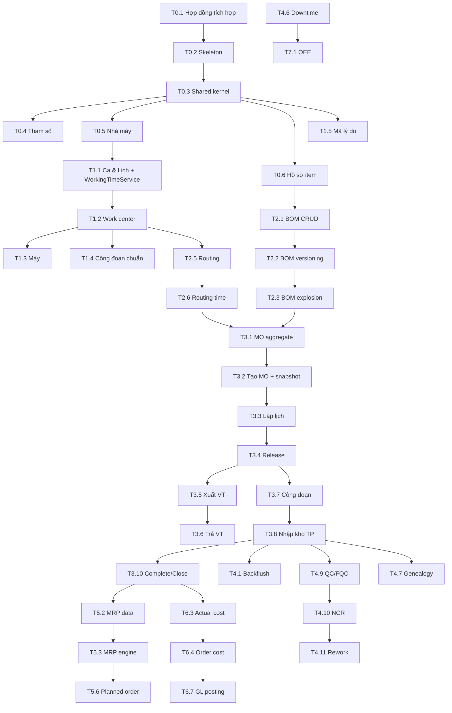

# MODULE SẢN XUẤT — KẾ HOẠCH TRIỂN KHAI & DANH SÁCH TASK

> **Vai trò tác giả:** Senior Lead Dev (phối hợp BA)
> **Đầu vào:** `01_PRODUCTION_BA_SPEC.md` (mọi mã `BR-*`, `PRD_*`, `S**`, §7 data model)
> **Đầu ra kiểm thử:** `03_PRODUCTION_TEST_CASES.md` (nhóm `TC-*`)
> **Phiên bản:** 1.0 · 2026-11-04

---

## 0. NGUYÊN TẮC SẮP XẾP

### 0.1 Vì sao thứ tự giai đoạn như dưới đây
1. **Nền tảng & tích hợp trước** (Phase 0): Sản xuất phụ thuộc Item, UoM, Warehouse, **Inventory (tồn, lô, giữ chỗ, giao dịch)**. Không có các hợp đồng này thì mọi task thực thi phải làm lại. Nếu module Inventory chưa xong (roadmap Phase 3 của ERP), **Phase 3 của Sản xuất không được bắt đầu**; Phase 0–2 vẫn làm song song được.
2. **Danh mục → Kỹ thuật → Thực thi**: lệnh sản xuất snapshot BOM/Routing, BOM/Routing tham chiếu work center & lịch. Đi ngược sẽ phải mock dữ liệu và sửa lại.
3. **Thực thi trước Kế hoạch (MRP)**: MRP cần lệnh sản xuất mở làm nguồn cung và nhu cầu phụ thuộc (BR-MRP-02, BR-MRP-03), và đầu ra MRP là lệnh sản xuất. Làm MRP trước thì không có nơi đích để chuyển đổi và không kiểm thử được netting đầy đủ.
4. **Giá thành sau Thực thi**: giá thành thực tế tổng hợp từ giao dịch xuất/báo cáo/nhập kho (BR-CST-02). Phase 3 đã lưu đủ số lượng, thời gian, `UnitCost` từ Inventory nên Phase 6 chỉ cần event handler, không phải sửa nghiệp vụ thực thi.
5. **Báo cáo/KPI cuối** vì cần dữ liệu downtime, báo cáo công đoạn, giá thành.

### 0.2 Mức ưu tiên
| Mức | Ý nghĩa |
|---|---|
| **P0** | Blocker — chặn task khác; phải xong trước trong phase |
| **P1** | Must — bắt buộc để đạt mục tiêu phase / MVP |
| **P2** | Should — giá trị cao, có thể lùi sang phase sau nếu trễ |
| **P3** | Could — mở rộng, làm khi còn nguồn lực |

### 0.3 Tổng quan giai đoạn (ước lượng man-day cho 1 senior dev có AI hỗ trợ)
| Phase | Tên | Mục tiêu / Milestone | Ước lượng | Phụ thuộc ngoài module |
|---|---|---|---|---|
| 0 | Nền tảng & tích hợp | Skeleton, shared kernel, tham số, nhà máy, hồ sơ item | 7.5 | Item, UoM, Warehouse, Identity |
| 1 | Danh mục sản xuất | Lịch, ca, work center, máy, lý do, tổ | 11 | Department, Employee |
| 2 | Dữ liệu kỹ thuật | BOM, Routing, phân rã, versioning | 21 | — |
| 3 | **Thực thi MVP** | **M1: chạy end-to-end lệnh SX thủ công** | 35 | **Inventory core** |
| 4 | Thực thi nâng cao & Chất lượng | Backflush, đảo, QC, NCR, truy xuất, tablet | 36.5 | Inventory lot/quarantine |
| 5 | Kế hoạch | **M2: MRP + năng lực** | 29 | Sales, Purchasing |
| 6 | Giá thành | **M3: giá thành & hạch toán** | 20.5 | Finance |
| 7 | Báo cáo, KPI, mở rộng | OEE, dashboard, bảo trì, ECO | 21 | — |
| | **Tổng** | MVP (Phase 0→3) = 74.5 · Toàn bộ = 181.5 | **181.5** | |

### 0.4 Sơ đồ phụ thuộc



---

## 1. QUY ƯỚC KỸ THUẬT & DEFINITION OF DONE

### 1.1 Cấu trúc thư mục (bám repo hiện có, namespace `ERP.E_Commerce`)
```
src/ERP.E_Commerce.Domain/Production/{Feature}/          Entity, Aggregate, Enum, ValueObject, DomainEvent
src/ERP.E_Commerce.Application/Production/{Feature}/     Dtos/, Validators/, Interfaces/I{Feature}Service.cs, Services/, Mappings/
src/ERP.E_Commerce.Application/Abstractions/Integration/ Interface tích hợp (BA §8)
src/ERP.E_Commerce.Infrastructure/Production/            Configurations/ (Fluent API, schema "production"), Repositories/, Adapters/, Jobs/
src/ERP.E_Commerce.API/Controllers/Production/           {Feature}Controller.cs   route: api/v1/production/{kebab-feature}
tests/ERP.E_Commerce.UnitTests/Production/...
tests/ERP.E_Commerce.IntegrationTests/Production/...
```
> Nếu repo đang dùng MediatR/CQRS thay vì Service, ánh xạ mỗi method service thành Command/Query tương ứng — giữ nguyên tên nghiệp vụ.

### 1.2 Template sub-task chuẩn cho một tính năng (ký hiệu **[STD]**)
Khi task ghi "[STD]", áp dụng đủ 7 bước sau (task chỉ liệt kê phần đặc thù):

| Bước | Tầng | Nội dung |
|---|---|---|
| a | Domain | Entity/aggregate + factory `Create(...)`, method nghiệp vụ bảo vệ invariant (ghi `/// BR-xxx`), không public setter cho trạng thái |
| b | Infrastructure | `IEntityTypeConfiguration<T>` Fluent API (schema `production`, độ dài, precision theo BA §7, unique index, RowVersion), migration, repository |
| c | Application | DTO (Create/Update/Response/ListItem/Filter), FluentValidation, AutoMapper profile, `I{X}Service` + impl, mã lỗi `PRD_*` |
| d | API | Controller, `[Authorize(Policy = Permissions.Production.X)]`, trả `ApiResponse<T>` / `ApiResponse<PaginatedResult<T>>`, Idempotency-Key cho POST giao dịch |
| e | Test | Unit test domain + service (mock tích hợp), integration test API + DB (Testcontainers SQL Server) |
| f | UI | Màn hình S** tương ứng: danh sách (lọc, sắp xếp, phân trang), form, chi tiết |
| g | Seed/Doc | Seed dữ liệu mẫu (nếu có), cập nhật Swagger mô tả |

### 1.3 Definition of Done (mọi task)
- [ ] Tuân thủ quy ước: async `Task`, `ApiResponse<T>`, `PaginatedResult<T>`, Fluent API, AutoMapper chỉ ở Service, lỗi tiếng Việt theo Phụ lục A BA.
- [ ] Mọi BR được tham chiếu có test (unit hoặc integration) xanh; trace mã BR trong tên test: `BR_PO_17_ReceiptExceedsTolerance_ReturnsError`.
- [ ] Test case QA tương ứng (`TC-*`) chạy pass ở môi trường dev.
- [ ] Migration chạy được trên DB rỗng và DB có dữ liệu; không sửa migration cũ đã merge.
- [ ] Không truy cập bảng module khác ngoài interface §8 BA.
- [ ] Code review + build CI xanh.

### 1.4 Prompt mẫu cho AI-assisted coding (Claude Code)
```
Bối cảnh: đọc docs/modules/production/01_PRODUCTION_BA_SPEC.md (mục {§}) và ARCHITECTURE_RULES.md.
Nhiệm vụ: thực hiện sub-task {T3.5.2} trong 02_PRODUCTION_DEV_TASKS.md.
Ràng buộc: chỉ tạo/sửa file thuộc tầng {Application}; tuân thủ BR {BR-MAT-02, BR-MAT-03};
dùng mã lỗi {PRD_MAT_002, PRD_MAT_003}; không thêm cột ngoài BA §7.
Kết thúc: liệt kê file đã tạo/sửa và test đã viết; đối chiếu test case {TC-MAT-001..010}.
```
Thực hiện **từng sub-task một**, commit theo sub-task, chạy test trước khi sang sub-task tiếp.

---

## PHASE 0 — NỀN TẢNG & TÍCH HỢP (7.5d)

### T0.1 Khảo sát & chốt hợp đồng tích hợp — **P0** · 1.5d · Phụ thuộc: —
BR: BA §8 · TC: TC-INT-*
- [ ] T0.1.1 Rà soát Item/Product: có `IsLotControlled`, `IsSerialControlled`, `BaseUomId`, `IsActive`? Thiếu → tạo issue bổ sung cho module Catalog.
- [ ] T0.1.2 Rà soát UoM: service quy đổi theo item + `DecimalPlaces`. Thiếu → bổ sung.
- [ ] T0.1.3 Rà soát Inventory: available theo kho/lô, reservation, giao dịch có loại tùy biến, lô có hạn dùng + trạng thái QC-Hold, FEFO suggest, trả về `UnitCost` khi xuất.
- [ ] T0.1.4 Tạo interface tại `Application/Abstractions/Integration/` đúng chữ ký BA §8 (+ DTO request/response).
- [ ] T0.1.5 Adapter Infrastructure gọi module thật; module chưa có → adapter stub `// TODO-INTEGRATION` + fake in-memory cho test.
- [ ] T0.1.6 Ghi kết quả gap vào `docs/modules/production/INTEGRATION_GAPS.md`.
**AC:** mọi interface §8 compile được, có fake implementation dùng trong unit test.

### T0.2 Skeleton module — **P0** · 1d · Phụ thuộc: T0.1
- [ ] T0.2.1 Tạo thư mục theo §1.1; extension `services.AddProductionModule(configuration)` (Application + Infrastructure).
- [ ] T0.2.2 Đăng ký configurations schema `production` vào DbContext hiện có (`ApplyConfigurationsFromAssembly` lọc namespace Production) — hoặc DbContext riêng nếu kiến trúc yêu cầu.
- [ ] T0.2.3 Migration khởi tạo rỗng `Production_Init`.
- [ ] T0.2.4 Swagger group "Production", route prefix `api/v1/production`.
- [ ] T0.2.5 Project test + fixture Testcontainers SQL Server + Respawn.

### T0.3 Shared kernel cho module — **P0** · 1.5d · Phụ thuộc: T0.2
BR: BR-GEN-01..09 · TC: TC-GEN-*
- [ ] T0.3.1 [Domain] Base `ProductionAggregateRoot` (audit, RowVersion, domain events), `ProductionDomainException(code, args)`.
- [ ] T0.3.2 [Domain] Toàn bộ enum dùng chung (OrderStatus, OperationStatus, IssueMethod, MakeOrBuy, LotSizingPolicy, ReasonType, …) theo BA §7.
- [ ] T0.3.3 [Application] `ProductionErrorCodes` + resource tiếng Việt (Phụ lục A BA), map exception → `ApiResponse` qua middleware sẵn có.
- [ ] T0.3.4 [Infrastructure] `IDocumentNumberService` (nếu chưa có): bảng `DocumentSequence(DocType, PlantId, Period, LastValue)` cập nhật `WITH (UPDLOCK, HOLDLOCK)` hoặc SQL SEQUENCE; format BR-GEN-04.
- [ ] T0.3.5 [API] Hằng số permission (BA §9) + seed + policy registration.
- [ ] T0.3.6 [Application] `IPlantContext` (nhà máy hiện hành, timezone, ngày nghiệp vụ — BR-GEN-05) + filter dữ liệu theo nhà máy được phân quyền (BR-GEN-09).
- [ ] T0.3.7 [Test] Test numbering đồng thời 50 request song song không trùng số.

### T0.4 Tham số sản xuất — **P1** · 1d · Phụ thuộc: T0.3, T0.5
BR: BR-SET-01..03 · UI: S01 · TC: TC-SET-*
- [ ] [STD] cho `ProductionSetting` (chỉ Get/Update, không Create/Delete).
- [ ] T0.4.1 `IProductionSettingProvider` có cache (IMemoryCache, invalidate khi update) — mọi service đọc tham số qua đây.
- [ ] T0.4.2 Kiểm tra BR-SET-03 khi đổi CostingMethod.
- [ ] T0.4.3 Audit giá trị cũ/mới.

### T0.5 Nhà máy — **P0** · 1d · Phụ thuộc: T0.3
BR: BR-PLT-01..03, BR-SET-01 · UI: S02 · TC: TC-PLT-*
- [ ] [STD] cho `Plant`.
- [ ] T0.5.1 Tạo Plant → tự tạo `ProductionSetting` mặc định trong cùng transaction.
- [ ] T0.5.2 Validate kho cùng công ty (qua `IWarehouseQuery`). `DefaultCalendarId` cho phép null đến khi có T1.1, bắt buộc khi Release lệnh.

### T0.6 Hồ sơ sản xuất của mặt hàng — **P0** · 1.5d · Phụ thuộc: T0.5
BR: BR-ITM-01..04 · UI: S03 · TC: TC-ITM-*
- [ ] [STD] cho `ItemManufacturingProfile` (UI là tab trong màn hình Item).
- [ ] T0.6.1 Validator chính sách lô theo BR-ITM-03.
- [ ] T0.6.2 `LowLevelCode`, `StandardCost` read-only qua API thường (chỉ service nội bộ cập nhật).
- [ ] T0.6.3 Query `GetProfileOrDefault(itemId, plantId)`.

---

## PHASE 1 — DANH MỤC SẢN XUẤT (11d)

### T1.1 Ca, Lịch làm việc & WorkingTimeService — **P0** · 3d · Phụ thuộc: T0.5
BR: BR-CAL-01..05 · UI: S04 · TC: TC-CAL-*
- [ ] [STD] cho `Shift`, `WorkCalendar` (+ Pattern, Exception, ExceptionShift).
- [ ] T1.1.1 [Domain] `Shift.DurationMinutes` (ca qua đêm), validate BR-CAL-01.
- [ ] T1.1.2 [Domain] Kiểm tra chồng lấn ca trong ngày (khoảng thời gian, xử lý qua đêm) — BR-CAL-02.
- [ ] T1.1.3 [Application] `IWorkingTimeService` (BR-CAL-05): `GetWorkingMinutes`, `GetWorkingIntervals(calendar, date)`, `AddWorkingMinutes`, `SubtractWorkingMinutes`, `AddWorkingDays`, `SubtractWorkingDays`. Cache lịch theo tháng.
- [ ] T1.1.4 [Test] Unit test bảng giá trị: ngày thường, thứ Bảy, Chủ nhật, ngày lễ, ca qua đêm, lùi qua nhiều ngày, 0 phút.
- [ ] T1.1.5 [UI] Calendar view tháng hiển thị phút làm việc/ngày, đánh dấu ngoại lệ.

### T1.2 Work center & năng lực — **P0** · 2d · Phụ thuộc: T1.1
BR: BR-WC-01..05 · UI: S05 · TC: TC-WC-*
- [ ] [STD] cho `WorkCenter`.
- [ ] T1.2.1 `ICapacityService.GetDailyCapacity(workCenterId, from, to)` theo BR-WC-02.
- [ ] T1.2.2 Deactivate: kiểm tra công đoạn lệnh mở (BR-WC-03) — tạm thời trả false đến khi có T3.1, viết test sau khi T3.1 xong.
- [ ] T1.2.3 Validate Subcontract cần VendorId (BR-WC-05).

### T1.3 Máy móc — **P1** · 1d · Phụ thuộc: T1.2
BR: BR-MCH-01..02 · UI: S06 · TC: TC-MCH-*
- [ ] [STD] cho `Machine`; thao tác đổi trạng thái (Active/UnderMaintenance/Retired).

### T1.4 Công đoạn chuẩn — **P2** · 0.5d · Phụ thuộc: T1.2
BR: BR-OPS-01 · UI: S07 · TC: TC-OPS-*
- [ ] [STD] cho `StandardOperation`.

### T1.5 Mã lý do — **P0** · 0.5d · Phụ thuộc: T0.3
BR: BR-RSN-01..02 · UI: S07 · TC: TC-RSN-*
- [ ] [STD] cho `ReasonCode`.
- [ ] T1.5.1 Seed mặc định: SCRAP-01 "Lỗi vật liệu", SCRAP-02 "Lỗi thao tác", RWK-01 "Sai kích thước", DT-01 "Hỏng máy" (Unplanned), DT-02 "Bảo trì định kỳ" (Planned), DT-03 "Chờ vật tư" (Unplanned), CAN-01 "Khách hủy đơn", HLD-01 "Chờ vật tư", SC-01 "Thiếu nguyên liệu", UPM-01 "Bổ sung ngoài định mức", OVI-01 "Hao hụt vượt định mức".

### T1.6 Tổ sản xuất & nhân công — **P2** · 1d · Phụ thuộc: T1.2
BR: BR-LBR-01..02 · UI: S07 · TC: TC-LBR-*
- [ ] [STD] cho `Crew`, `CrewMember`.
- [ ] T1.6.1 `ILaborRateResolver.GetRate(employeeId, workCenterId, date)` theo BR-LBR-02.

### T1.7 Gói UI danh mục — **P1** · 3d · Phụ thuộc: T1.1–T1.5
- [ ] T1.7.1 S04, S05 (biểu đồ năng lực 4 tuần), S06, S07; dùng chung component danh sách/form hiện có của dự án.

---

## PHASE 2 — DỮ LIỆU KỸ THUẬT (21d)

### T2.1 BOM: aggregate & CRUD bản Draft — **P0** · 3d · Phụ thuộc: T0.6
BR: BR-BOM-01, 02, 05, 07, 09, 11, 12 · TC: TC-BOM-*
- [ ] [STD] cho `Bom` (aggregate root) + `BomLine` (child, chỉ sửa qua aggregate).
- [ ] T2.1.1 [Domain] `Bom.AddLine/UpdateLine/RemoveLine` chỉ khi Draft (`PRD_BOM_002`); validate số lượng, hao hụt, yield.
- [ ] T2.1.2 [Domain] Kiểm tra tự tham chiếu (component = parent).
- [ ] T2.1.3 [Domain] Kiểm tra nhóm thay thế (đúng một priority 1), unique (Component, OperationSeq), tổng CostAllocationPct.
- [ ] T2.1.4 [Application] Validate UoM quy đổi được (`IUomConversionService`).
- [ ] T2.1.5 API: `POST /boms`, `PUT /boms/{id}`, `POST /boms/{id}/lines`, `PUT/DELETE /boms/{id}/lines/{lineNo}`, `GET /boms?itemId=&status=`.

### T2.2 BOM: phiên bản & phê duyệt — **P0** · 3d · Phụ thuộc: T2.1
BR: BR-BOM-02, 03, 04, 13, 14, 15 · TC: TC-BOM-*
- [ ] T2.2.1 [Domain] `Approve(effectiveFrom, effectiveTo)`, `Obsolete(effectiveTo)`, `CopyAsNewDraft()`.
- [ ] T2.2.2 [Application] Kiểm tra chồng lấn hiệu lực + tự đóng `EffectiveTo` bản trước (BR-BOM-03).
- [ ] T2.2.3 [Application] `IBomCycleDetector`: DFS trên đồ thị BOM Approved + bản đang duyệt, trả đường dẫn vòng (`A > B > C > A`).
- [ ] T2.2.4 [Application] `ILowLevelCodeCalculator`: tính lại LLC toàn nhà máy khi Approve/Obsolete (BFS theo cấp, max depth) — BR-BOM-13; ghi vào profile.
- [ ] T2.2.5 [Application] Cảnh báo BR-RT-08 (OperationSeq không có trong routing hiệu lực) — không chặn.
- [ ] T2.2.6 API: `POST /boms/{id}/approve`, `/obsolete`, `/copy`.

### T2.3 Dịch vụ phân rã BOM — **P0** · 3d · Phụ thuộc: T2.2
BR: BR-BOM-06, 08, 10, 11 · TC: TC-BOM-*
- [ ] T2.3.1 `IBomResolver.GetEffectiveBom(itemId, plantId, date)` (BR-BOM-03).
- [ ] T2.3.2 `IBomExplosionService.ExplodeSingleLevel(bom, orderQty)` → danh sách nhu cầu theo BR-BOM-06 (thường/fixed, hao hụt, yield, quy đổi base UoM, làm tròn lên theo DecimalPlaces), phantom xuyên qua (đệ quy), chỉ lấy priority 1 trong nhóm thay thế, tách đầu ra By/CoProduct.
- [ ] T2.3.3 `ExplodeMultiLevel(itemId, qty, date)` → cây indented (dùng cho tra cứu, MRP, cost roll-up), giới hạn `MaxBomLevels`.
- [ ] T2.3.4 [Test] Bộ test số liệu chuẩn QA (TC-BOM-030..040) — ví dụ đơn 100 TP-BAN01 → SON-PU 52.50; đơn 7 → 3.68.
- [ ] T2.3.5 Hiệu năng NFR-02 (benchmark 5 cấp × 200).

### T2.4 Tra cứu BOM: indented, where-used, so sánh — **P2** · 1d · Phụ thuộc: T2.3
TC: TC-BOM-*
- [ ] T2.4.1 `GET /boms/{id}/indented?qty=`; `GET /items/{id}/where-used` (đệ quy ngược); `GET /boms/compare?left=&right=` (thêm/bớt/đổi SL).

### T2.5 Routing: aggregate, CRUD & phiên bản — **P0** · 3d · Phụ thuộc: T1.2, T1.4
BR: BR-RT-01..03, BR-RT-06 · UI: S09 · TC: TC-RT-*
- [ ] [STD] cho `Routing` + `RoutingOperation` (versioning giống T2.2: Approve/Obsolete/Copy, chồng lấn hiệu lực).
- [ ] T2.5.1 Thêm công đoạn từ công đoạn chuẩn (copy giá trị — BR-OPS-01).

### T2.6 Dịch vụ thời gian routing — **P0** · 1.5d · Phụ thuộc: T2.5, T1.1
BR: BR-RT-04, 05 · TC: TC-RT-*
- [ ] T2.6.1 `IOperationTimeCalculator.GetStandardMinutes(op, qty)` và `GetCalendarMinutes(op, qty, efficiency)` (làm tròn lên phút).
- [ ] T2.6.2 `GetRoutingLeadTime(routing, qty)` dùng `IWorkingTimeService`.

### T2.7 Kiểm tra liên kết BOM–Routing — **P1** · 0.5d · Phụ thuộc: T2.3, T2.6
BR: BR-RT-08 · TC: TC-RT-*
- [ ] T2.7.1 Hàm dùng chung cho Approve BOM (cảnh báo) và tạo lệnh (gán công đoạn đầu + cảnh báo).

### T2.8 UI BOM & Routing — **P1** · 4d · Phụ thuộc: T2.1–T2.6
UI: S08, S09
- [ ] T2.8.1 Editor BOM dạng cây (mở rộng phantom, đánh dấu nhóm thay thế, đồng/phụ phẩm), nút Approve/Obsolete/Copy.
- [ ] T2.8.2 Routing editor (lưới công đoạn, kéo thả đổi thứ tự → đánh số lại 10, 20…), xem lead time theo SL nhập.
- [ ] T2.8.3 Màn hình so sánh phiên bản, where-used.

### T2.9 Import BOM/Routing từ Excel — **P2** · 2d · Phụ thuộc: T2.2, T2.5
- [ ] T2.9.1 Template Excel, validate toàn bộ file trước khi ghi (báo lỗi theo dòng), tạo bản Draft.

---

## PHASE 3 — THỰC THI MVP (35d) · Milestone **M1**

> Điều kiện bắt đầu: Inventory core sẵn sàng (T0.1.3 không còn stub cho available/reservation/transaction).

### T3.1 ProductionOrder aggregate & máy trạng thái — **P0** · 3d · Phụ thuộc: T2.3, T2.6
BR: BR-PO-01, 02, 19, BR-GEN-03 · TC: TC-PO-*
- [ ] T3.1.1 [Domain] Aggregate `ProductionOrder` gồm `Materials`, `Operations`, `Outputs`, `StatusHistory`; mọi thay đổi qua method.
- [ ] T3.1.2 [Domain] `OrderStateMachine`: bảng chuyển hợp lệ theo BA §4.2; `TransitionTo(target, reason)` ném `PRD_PO_002`; ghi history; lưu `StatusBeforeHold`.
- [ ] T3.1.3 [Domain] `OperationStateMachine` theo BA §4.3.
- [ ] T3.1.4 [Infrastructure] Config EF (owned/child collections, index BA §7.3), repository `GetWithDetailsAsync`.
- [ ] T3.1.5 [Test] Bảng test mọi cặp (from, to) hợp lệ/không hợp lệ.

### T3.2 Tạo lệnh & snapshot — **P0** · 2.5d · Phụ thuộc: T3.1
BR: BR-PO-03, 04, 05, BR-RT-07, 08 · UI: S15, S16 · TC: TC-PO-*
- [ ] T3.2.1 [Application] `CreateAsync(dto)`: validate BR-PO-03, chọn BOM/Routing BR-PO-04, sinh số BR-PO-01.
- [ ] T3.2.2 [Application] `SnapshotBuilder`: dùng `IBomExplosionService.ExplodeSingleLevel` → Materials (IssueMethod: dòng BOM → profile → setting), Outputs; copy Operations; xử lý BR-RT-08.
- [ ] T3.2.3 [Application] `UpdateDraftAsync` (Qty/BOM/Routing/DueDate/Priority) → Regenerate.
- [ ] T3.2.4 API: `POST /orders`, `PUT /orders/{id}`, `GET /orders` (lọc Status, Item, DueDate, IsLate, Priority), `GET /orders/{id}`.

### T3.3 Lập lịch vô hạn năng lực — **P1** · 2d · Phụ thuộc: T3.2, T2.6
BR: BR-PO-06, BR-SCH-01 · TC: TC-SCH-*
- [ ] T3.3.1 `IOrderScheduler.ScheduleBackward(order)` / `ScheduleForward(order, from)`; đặt PlannedStart/End cho lệnh & từng công đoạn, `IsLate`.
- [ ] T3.3.2 Gọi khi tạo/regenerate/đổi DueDate/đổi số lượng.
- [ ] T3.3.3 [Test] Kịch bản QA TC-SCH-001..004 (DueDate 2026-11-13 → start 2026-11-11).

### T3.4 Release / Unrelease — **P0** · 2d · Phụ thuộc: T3.3
BR: BR-PO-07, 08, 09 · TC: TC-PO-*
- [ ] T3.4.1 `CheckAvailabilityAsync(orderId)` → danh sách thiếu (dùng cho cả UI trước khi Release).
- [ ] T3.4.2 `ReleaseAsync`: validate, reservation qua `IInventoryReservationService` (cùng transaction), set trạng thái công đoạn, event `ProductionOrderReleased`.
- [ ] T3.4.3 `UnreleaseAsync`: kiểm tra chưa có giao dịch, release reservation.

### T3.5 Xuất vật tư thủ công — **P0** · 3d · Phụ thuộc: T3.4
BR: BR-MAT-01..04, BR-MAT-06, BR-MAT-07, BR-PO-10, BR-GEN-08 · UI: S18 · TC: TC-MAT-*
- [ ] T3.5.1 [Domain] `MaterialTransaction` (Type=Issue) + lines + serial; `ProductionOrderMaterial.RegisterIssue(qty)` kiểm BR-MAT-02.
- [ ] T3.5.2 [Application] `IssueAsync(dto)`: kiểm trạng thái, tolerance + quyền OverIssue, tồn khả dụng, lô (hết hạn/QC-hold), serial; gợi ý FEFO `SuggestLotsAsync`.
- [ ] T3.5.3 [Application] Unit of Work: lưu phiếu + `IInventoryTransactionService.PostAsync` + `ConsumeReservation` trong **một** transaction (BR-MAT-06); lưu `UnitCost/Amount` trả về.
- [ ] T3.5.4 Tự chuyển InProgress (BR-PO-10); event `MaterialIssued`.
- [ ] T3.5.5 API `POST /orders/{id}/material-issues` (Idempotency-Key), `GET /orders/{id}/material-issues/suggest-lots`.
- [ ] T3.5.6 [Test] Integration test rollback khi Inventory ném lỗi giữa chừng.

### T3.6 Trả vật tư — **P1** · 1.5d · Phụ thuộc: T3.5
BR: BR-MAT-05, 06 · TC: TC-MAT-*
- [ ] T3.6.1 `ReturnAsync`: giới hạn theo NetIssued dòng và theo lô; giao dịch `ProductionReturn`; event `MaterialReturned`.

### T3.7 Thực hiện công đoạn — **P0** · 4d · Phụ thuộc: T3.4
BR: BR-OP-01..06, BR-OP-09, BR-MCH-02, BR-PO-10, 11 · UI: S16 (tab Công đoạn) · TC: TC-OP-*
- [ ] T3.7.1 [Domain] `LaborTimeLog` Start/Pause/Resume/Stop; tính `DurationMinutes`, `PausedMinutes`.
- [ ] T3.7.2 [Application] `StartAsync/PauseAsync/ResumeAsync/StopAsync`: kiểm BR-OP-02, BR-OP-05 (chồng lấn theo nhân viên), máy Retired.
- [ ] T3.7.3 [Domain] `ProductionOrderOperation.Report(good, scrap, rework)`: BR-OP-03, giới hạn đầu vào BR-OP-04, cập nhật lũy kế; Ready hóa công đoạn sau BR-OP-01; tự Completed BR-OP-06.
- [ ] T3.7.4 [Application] `ReportAsync` tạo `OperationReport` (số OR), cập nhật `ScrappedQty` lệnh, event `OperationReported` (backflush gắn vào Phase 4 qua handler).
- [ ] T3.7.5 `CompleteOperationManualAsync`, `ReopenOperationAsync` (quyền).
- [ ] T3.7.6 Hold lệnh → Pause các time log Running (BR-PO-11).

### T3.8 Nhập kho thành phẩm — **P0** · 2.5d · Phụ thuộc: T3.7
BR: BR-FG-01..03, BR-FG-05, BR-PO-14a, 17 · UI: S19 · TC: TC-FG-*
- [ ] T3.8.1 [Application] `ReceiveAsync`: giới hạn BR-FG-01/BR-PO-17; lô tự sinh theo `FgLotNumberFormat` (+ seq trong ngày), Mfg/Expiry; serial.
- [ ] T3.8.2 Ghi `ILotService.CreateAsync` + `IInventoryTransactionService` `ProductionReceipt` (cùng transaction).
- [ ] T3.8.3 Cập nhật `CompletedQty`, auto-complete; event `FinishedGoodsReceived`.
- [ ] T3.8.4 Nhánh `RequiresFqc` ghi vào kho chờ kiểm (cờ IsQcHold) — tạo phiếu FQC ở T4.9 qua event handler.

### T3.9 Hold/Resume, Đổi số lượng, Hủy — **P1** · 2d · Phụ thuộc: T3.4
BR: BR-PO-11, 12, 13 · TC: TC-PO-*
- [ ] T3.9.1 `HoldAsync/ResumeAsync` (lý do Type=Hold).
- [ ] T3.9.2 `ChangeQuantityAsync` (quyền, ≥ CompletedQty, tính lại Required, điều chỉnh reservation, lập lịch lại).
- [ ] T3.9.3 `CancelAsync` (lý do Type=Cancel, chưa giao dịch, release reservation).

### T3.10 Complete / Short-close / Reopen / Close — **P0** · 2.5d · Phụ thuộc: T3.8
BR: BR-PO-14, 15, 16 · TC: TC-PO-*
- [ ] T3.10.1 `CompleteAsync(orderId, reasonId?)`: phân nhánh (b)/(c) theo UnderTol + quyền ShortClose.
- [ ] T3.10.2 `ReopenAsync`.
- [ ] T3.10.3 `GetCloseChecklistAsync` → danh sách điều kiện BR-PO-16 (đạt/không đạt) cho UI.
- [ ] T3.10.4 `CloseAsync(orderId, confirmConsumeRemaining)`: ghi nhận tiêu hao phần NetIssued còn lại nếu xác nhận; điều kiện (5) chỉ kiểm khi cost module bật (feature flag).

### T3.11 Lịch sử, audit & domain events — **P1** · 1d · Phụ thuộc: T3.1
BR: BR-PO-02, BR-GEN-01 · TC: TC-GEN-*
- [ ] T3.11.1 Dispatch domain events sau commit (outbox nếu dự án đã có); `GET /orders/{id}/history`.

### T3.12 UI lệnh sản xuất — **P1** · 5d · Phụ thuộc: T3.2–T3.10
UI: S15, S16, S18, S19
- [ ] T3.12.1 S15 danh sách: badge trạng thái, cờ trễ hạn, lọc nâng cao, hành động hàng loạt Release.
- [ ] T3.12.2 S16 chi tiết: tabs; panel kiểm tra khả dụng; các nút hành động hiển thị theo trạng thái + quyền.
- [ ] T3.12.3 S18 phiếu xuất/trả (gợi ý FEFO, quét mã lô).
- [ ] T3.12.4 S19 nhập kho TP (sinh lô, in tem).
- [ ] T3.12.5 Checklist đóng lệnh.

### T3.13 In ấn — **P2** · 2d · Phụ thuộc: T3.12
UI: S30
- [ ] T3.13.1 PDF Lệnh sản xuất (kèm QR số lệnh), Phiếu xuất VT, Phiếu nhập TP, Tem lô (QR: ItemCode|LotNo|Expiry).

### T3.14 Kiểm thử E2E MVP — **P0** · 2d · Phụ thuộc: T3.1–T3.12
TC: TC-E2E-001..003
- [ ] T3.14.1 Tự động hóa kịch bản E2E (Playwright/API) + seed bộ dữ liệu chuẩn QA (`ProductionTestDataSeeder`).

**Milestone M1 — Tiêu chí:** TC-E2E-001 pass; mọi TC P1 của nhóm PO, MAT, OP, FG pass; 0 bug Critical/High.

---

## PHASE 4 — THỰC THI NÂNG CAO & CHẤT LƯỢNG (36.5d)

### T4.1 Backflush — **P1** · 3d · Phụ thuộc: T3.7, T3.8
BR: BR-MAT-08 · TC: TC-BF-*
- [ ] T4.1.1 `BackflushService.Calculate(order, trigger)` lũy kế + làm tròn lên (BR-MAT-08).
- [ ] T4.1.2 Chọn lô FEFO tự động; xử lý thiếu tồn theo `AllowNegativeStockOnBackflush`.
- [ ] T4.1.3 Gọi **đồng bộ trong cùng transaction** với báo cáo công đoạn / nhập kho (không qua event bất đồng bộ) để rollback được toàn bộ.
- [ ] T4.1.4 Ghi `MaterialTransaction` Type=Backflush liên kết `SourceOperationReportId`/`SourceReceiptId`.

### T4.2 Đảo báo cáo công đoạn & đảo nhập kho — **P1** · 2.5d · Phụ thuộc: T4.1
BR: BR-OP-07, BR-FG-07 · TC: TC-REV-*
- [ ] T4.2.1 `ReverseOperationReportAsync`: kiểm hạ nguồn, tạo bản đối ứng, đảo backflush, mở lại công đoạn nếu cần.
- [ ] T4.2.2 `ReverseReceiptAsync`: kiểm tồn lô, FQC, đảo backflush, giảm CompletedQty, tự Reopen.

### T4.3 Yêu cầu cấp vật tư — **P2** · 2.5d · Phụ thuộc: T3.5
BR: BR-MAT-10 · UI: S17 · TC: TC-MQ-*
- [ ] [STD] cho `MaterialRequest`; trạng thái tự cập nhật khi phiếu xuất tham chiếu.

### T4.4 Thay thế vật tư & vật tư ngoài định mức — **P2** · 1.5d · Phụ thuộc: T3.5
BR: BR-MAT-09, 11 · TC: TC-MAT-*
- [ ] T4.4.1 `SubstituteAsync(orderId, lineNo, substituteItemId, primaryQty)`.
- [ ] T4.4.2 `AddUnplannedMaterialAsync`.

### T4.5 Nhập đồng/phụ phẩm — **P2** · 1.5d · Phụ thuộc: T3.8
BR: BR-FG-06 · TC: TC-FG-*
- [ ] T4.5.1 Mở rộng `ReceiveAsync` nhận nhiều dòng (Main/CoProduct/ByProduct).

### T4.6 Ghi nhận dừng máy — **P1** · 1.5d · Phụ thuộc: T1.3, T1.5
BR: BR-OP-08 · UI: S20 · TC: TC-DT-*
- [ ] [STD] cho `DowntimeLog` (start/stop hoặc nhập khoảng).

### T4.7 Genealogy & truy xuất — **P1** · 3d · Phụ thuộc: T3.8, T4.1
BR: BR-TR-01, 02 · UI: S24 · TC: TC-TR-*
- [ ] T4.7.1 Ghi `LotGenealogy` khi nhập kho (từ tất cả lô vật tư ròng > 0 của lệnh); cập nhật khi đảo.
- [ ] T4.7.2 Truy ngược/xuôi đệ quy (CTE SQL `sp_GetLotGenealogyBackward`/`sp_GetLotGenealogyForward` hoặc LINQ), giới hạn cấp.
- [ ] T4.7.3 UI cây truy xuất, export Excel.

### T4.8 Kế hoạch kiểm tra — **P1** · 2d · Phụ thuộc: T0.6
BR: BR-QC-01 · UI: S21 · TC: TC-QC-*
- [ ] [STD] cho `InspectionPlan` + `InspectionCharacteristic` (versioning Draft/Approved/Obsolete).

### T4.9 Phiếu kiểm tra IPQC/FQC & chờ kiểm — **P1** · 3d · Phụ thuộc: T4.8, T3.8
BR: BR-FG-04, BR-QC-02..06, BR-OP-04 (IPQC) · UI: S22 · TC: TC-QC-*
- [ ] T4.9.1 Handler `FinishedGoodsReceived` → tạo FQC; handler `OperationReported` → tạo IPQC nếu công đoạn có plan.
- [ ] T4.9.2 Tính cỡ mẫu BR-QC-03; nhập kết quả; đánh giá BR-QC-04.
- [ ] T4.9.3 Pass FQC → `QcRelease` transfer + lô Available; Pass IPQC → tăng `IpqcPassedQty`.
- [ ] T4.9.4 Kiểm tra lại (re-inspection).

### T4.10 NCR & xử lý — **P1** · 2.5d · Phụ thuộc: T4.9
BR: BR-NCR-01..04 · UI: S23 · TC: TC-NCR-*
- [ ] T4.10.1 Tự tạo NCR khi Fail; tạo tay từ báo cáo công đoạn.
- [ ] T4.10.2 Disposition tách dòng; Scrap → `ProductionScrap`; UseAsIs → quyền + release QC; Rework → gọi T4.11.

### T4.11 Lệnh Rework — **P2** · 2.5d · Phụ thuộc: T4.10
BR: BR-RW-01..03 · TC: TC-RW-*
- [ ] T4.11.1 Tạo lệnh Rework từ NCR; vật tư = hàng lỗi (kho chờ kiểm, đúng lô); nhập lại lô hậu tố `-R{n}`, luôn FQC.

### T4.12 Lệnh con bán thành phẩm — **P2** · 2d · Phụ thuộc: T3.4
BR: BR-PO-18 · TC: TC-PO-*
- [ ] T4.12.1 "Tạo lệnh con" cho dòng vật tư Make thiếu hàng; DueDate con = ngày làm việc trước PlannedStart cha.

### T4.13 Terminal xưởng (Tablet) — **P2** · 5d · Phụ thuộc: T3.7, T4.6
UI: S20 · NFR-07 · TC: TC-UI-*
- [ ] T4.13.1 Đăng nhập theo mã nhân viên/thẻ, chọn work center.
- [ ] T4.13.2 Quét QR lệnh → danh sách công đoạn Ready; Start/Pause/Stop; báo cáo SL (bàn phím số lớn); downtime.
- [ ] T4.13.3 Chế độ offline ngắn hạn: không hỗ trợ v1 — hiển thị trạng thái mất kết nối rõ ràng.

### T4.14 Gia công ngoài — **P3** · 4d · Phụ thuộc: T3.7, Purchasing
BR: BR-SC-01..03 · TC: TC-SC-*
- [ ] T4.14.1 Tạo PR dịch vụ khi Release; chuyển kho vật tư sang kho nhà gia công; nhận về = báo cáo công đoạn.

---

## PHASE 5 — KẾ HOẠCH (29d) · Milestone **M2**

### T5.1 Dự báo nhu cầu — **P1** · 2d · Phụ thuộc: T0.6
BR: BR-MRP-01 · UI: S10 · TC: TC-MRP-*
- [ ] [STD] cho `DemandForecast` (grid theo tuần, PeriodStart chuẩn hóa về thứ Hai); import Excel.

### T5.2 Thu thập dữ liệu cung/cầu — **P0** · 3d · Phụ thuộc: T3.10, T0.1
BR: BR-MRP-01..03 · TC: TC-MRP-*
- [ ] T5.2.1 `IMrpDataProvider`: snapshot (đọc 1 lần, `READ COMMITTED SNAPSHOT`) item profile, tồn khả dụng, SO mở, PO mua mở, lệnh SX mở + nhu cầu vật tư còn lại, planned order firm, dự báo.
- [ ] T5.2.2 Tiêu dùng dự báo BR-MRP-01.

### T5.3 MRP engine — **P0** · 6d · Phụ thuộc: T5.2, T2.3
BR: BR-MRP-04..07, 11 · TC: TC-MRP-*
- [ ] T5.3.1 Vòng lặp theo LLC tăng dần; netting theo ngày; tồn an toàn.
- [ ] T5.3.2 `ILotSizer` 4 chính sách (strategy pattern).
- [ ] T5.3.3 Lead time offset bằng `SubtractWorkingDays` lịch mặc định nhà máy; PastDueStart.
- [ ] T5.3.4 Phân rã planned order Make → nhu cầu phụ thuộc cấp dưới (BOM hiệu lực tại PlannedStart).
- [ ] T5.3.5 Pegging.
- [ ] T5.3.6 Engine thuần (pure, không truy cập DB) để unit test dễ; persistence tách riêng (bulk insert).
- [ ] T5.3.7 [Test] Kịch bản số liệu TC-MRP-010..020; NFR-04 benchmark.

### T5.4 Điều phối chạy MRP — **P1** · 2d · Phụ thuộc: T5.3
BR: BR-MRP-07, 09 · UI: S11 · TC: TC-MRP-*
- [ ] T5.4.1 Background job (Hangfire nếu dự án đã dùng, hoặc `BackgroundService` + queue); khóa theo nhà máy (`sp_getapplock`).
- [ ] T5.4.2 `MrpRun` trạng thái, thống kê, lỗi; API `POST /mrp/runs`, `GET /mrp/runs/{id}`.

### T5.5 Thông điệp ngoại lệ — **P1** · 2d · Phụ thuộc: T5.3
BR: BR-MRP-10 · TC: TC-MRP-*
- [ ] T5.5.1 Sinh 7 loại ngoại lệ; lọc/nhóm theo item.

### T5.6 Planned order workbench — **P1** · 3d · Phụ thuộc: T5.4
BR: BR-MRP-07, 08, 11 · UI: S12 · TC: TC-MRP-*
- [ ] T5.6.1 Firm/unfirm, sửa SL/ngày (tự firm khi sửa), xem pegging.
- [ ] T5.6.2 Chuyển đổi hàng loạt: Make → `ProductionOrderService.CreateAsync` (Source=Mrp); Buy → `IPurchaseRequestService` (gộp theo vendor).

### T5.7 Tải năng lực (CRP) — **P1** · 3d · Phụ thuộc: T3.3, T1.2
BR: BR-CAP-01, 02 · UI: S13 · TC: TC-CAP-*
- [ ] T5.7.1 `ICapacityLoadService.GetLoad(workCenterIds, from, to)` phân bổ phút chuẩn theo ngày.
- [ ] T5.7.2 Heatmap work center × ngày; drill-down danh sách công đoạn.

### T5.8 Gantt & lập lịch hữu hạn — **P3** · 8d · Phụ thuộc: T5.7
BR: BR-SCH-02 · UI: S14 · TC: TC-SCH-*
- [ ] T5.8.1 Thuật toán xếp lịch hữu hạn; T5.8.2 Gantt kéo thả với kiểm tra ràng buộc.

---

## PHASE 6 — GIÁ THÀNH (20.5d) · Milestone **M3**

### T6.1 Kỳ giá thành & khóa sổ — **P0** · 1.5d · Phụ thuộc: T0.3
BR: BR-CST-07, BR-GEN-08 · UI: S27 · TC: TC-CST-*
- [ ] T6.1.1 `CostPeriod`; `IPeriodGuard.EnsureOpen(plantId, postingDate)` gọi ở **mọi** service giao dịch (bổ sung vào T3.5–T3.8, T4.*).

### T6.2 Giá chuẩn roll-up — **P1** · 4d · Phụ thuộc: T2.3, T2.6
BR: BR-CST-01 · UI: S25 · TC: TC-CST-*
- [ ] T6.2.1 Roll-up theo LLC giảm dần; chi tiết NVL/nhân công/SXC/gia công.
- [ ] T6.2.2 Phiên bản giá Draft/Approved; Approved cập nhật `StandardCost` profile.

### T6.3 Tập hợp chi phí thực tế — **P0** · 3d · Phụ thuộc: T3.5–T3.8, T6.1
BR: BR-CST-02 · TC: TC-CST-*
- [ ] T6.3.1 Handler các event Issue/Return/Backflush/Report(labor)/Receipt cập nhật `ProductionOrderCost` (idempotent theo DocNo).
- [ ] T6.3.2 Đơn giá nhân công qua `ILaborRateResolver`.

### T6.4 Tính giá thành lệnh & định giá nhập kho — **P0** · 3d · Phụ thuộc: T6.3
BR: BR-CST-03, 04 · UI: S26 · TC: TC-CST-*
- [ ] T6.4.1 `CalculateOrderCostAsync`: phụ phẩm, phân bổ đồng phẩm, đơn giá.
- [ ] T6.4.2 Điều chỉnh giá trị nhập kho khi Close (Actual) — gửi điều chỉnh giá vốn sang Inventory.

### T6.5 Phân tích chênh lệch — **P1** · 2.5d · Phụ thuộc: T6.4, T6.2
BR: BR-CST-05 · TC: TC-CST-*

### T6.6 Đánh giá dở dang — **P1** · 1.5d · Phụ thuộc: T6.3
BR: BR-CST-06 · TC: TC-CST-*

### T6.7 Hạch toán kế toán — **P1** · 3d · Phụ thuộc: T6.4, Finance
BR: BR-CST-08 · TC: TC-CST-*
- [ ] T6.7.1 `CostAccountMapping` seed TT200; `IJournalPostingService` idempotent theo SourceKey; retry/outbox.

### T6.8 Quy trình khóa kỳ — **P1** · 2d · Phụ thuộc: T6.4–T6.7
BR: BR-CST-07 · TC: TC-CST-*
- [ ] T6.8.1 Checklist trước khóa (lệnh chưa tính giá, bút toán lỗi), khóa/mở kỳ có quyền.

---

## PHASE 7 — BÁO CÁO, KPI & MỞ RỘNG (21d)

### T7.1 OEE — **P1** · 3d · Phụ thuộc: T4.6, T3.7
BR: BR-KPI-01 · TC: TC-KPI-*
### T7.2 Gói báo cáo H01–H04, H06, H07, H09 — **P1** · 4d · Phụ thuộc: Phase 3–5
BR: BR-KPI-02..05 · UI: S28 · TC: TC-RPT-*
- [ ] Mỗi báo cáo: stored procedure `sp_Report{Name}` hoặc query tối ưu, filter, export Excel/PDF.
### T7.3 Dashboard — **P2** · 3d · Phụ thuộc: T7.1, T7.2 · UI: S29
### T7.4 Bảo trì phòng ngừa — **P3** · 5d · Phụ thuộc: T1.3, T4.6 (G01, G02)
### T7.5 ECO (yêu cầu thay đổi kỹ thuật) — **P3** · 4d · Phụ thuộc: T2.2, T2.5 (B05)
### T7.6 Tối ưu hiệu năng & lưu trữ — **P2** · 2d · Phụ thuộc: tất cả · NFR-01..04 · TC: TC-PERF-*

---

## PHỤ LỤC — THỨ TỰ THỰC HIỆN TUẦN TỰ (1 dev)

```
T0.1 → T0.2 → T0.3 → T0.5 → T0.4 → T0.6
→ T1.1 → T1.2 → T1.5 → T1.3 → T1.4 → T1.6 → T1.7
→ T2.1 → T2.2 → T2.3 → T2.5 → T2.6 → T2.7 → T2.4 → T2.8 → T2.9
→ T3.1 → T3.2 → T3.3 → T3.4 → T3.5 → T3.6 → T3.7 → T3.8 → T3.9 → T3.10 → T3.11 → T3.12 → T3.14 → T3.13   [M1]
→ T6.1 (sớm để chèn period guard)
→ T4.1 → T4.2 → T4.6 → T4.8 → T4.9 → T4.10 → T4.7 → T4.11 → T4.3 → T4.4 → T4.5 → T4.12 → T4.13 → T4.14
→ T5.1 → T5.2 → T5.3 → T5.4 → T5.5 → T5.6 → T5.7   [M2] → T5.8
→ T6.3 → T6.4 → T6.2 → T6.5 → T6.6 → T6.7 → T6.8   [M3]
→ T7.1 → T7.2 → T7.3 → T7.6 → T7.4 → T7.5
```
**Song song khi có 2 dev:** Dev A theo trục Kỹ thuật → Thực thi; Dev B làm T1.7, T2.8, T3.12 (UI) và T4.8 (QC plan) sớm; T5.1 có thể làm ngay sau T0.6.
